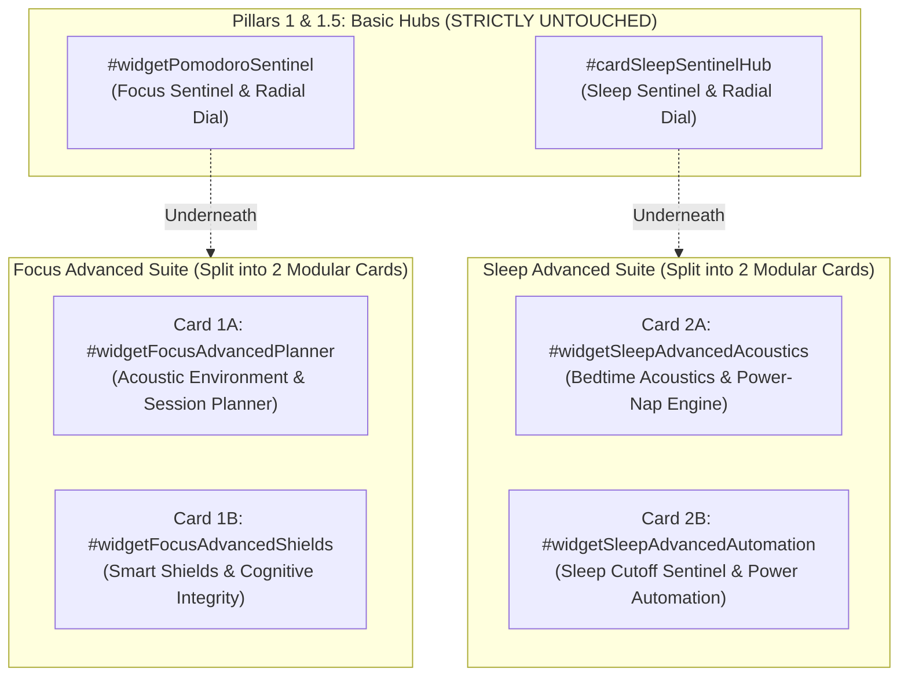

# Executive Architecture Summary: UI Advanced Controls Split & Modernization

> **Task ID:** `TASK-UI-ADVANCED-CONTROLS-SPLIT-001`  
> **Initiative:** Web Activity & Media Sentinel — Focus & Sleep Advanced Controls Modular Split & Modernization  
> **Author:** Level 3C Phase-wise Prompt Generation Specialist  
> **Target Scope:** `dashboard/dashboard.html`, `dashboard/styles/focus_sleep_advanced.css`, `dashboard/styles/tokens.css`  

---

## 🏛️ 1. Background & Initiative Scope

The "Focus & Digital Wellbeing" hub in the Web Activity & Media Sentinel dashboard provides critical ergonomics, distraction management, and media sleep controls for high-intensity knowledge workers. 

While the basic section cards (**Pillar 1: Focus Sentinel & Pomodoro Hero** `#widgetPomodoroSentinel` and **Pillar 1.5: Sleep Sentinel Hub** `#cardSleepSentinelHub`) feature polished SVG radial dials and interactive presets, the advanced sections directly beneath them currently suffer from visual crowding, monolithic DOM architectures, obsolete checkbox inputs, and single-column layout constraints:

1. **`#widgetFocusAdvanced` (Pillar 1B: Focus Advanced Controls):** Monolith combining goal planning, custom duration steppers, ambient sound generators, completion chimes, strict distraction shields, and posture timers in a single vertical list.
2. **`#cardSleepAdvanced` (Pillar 1.5B: Sleep Advanced Controls):** Monolith combining power-nap triggers, custom sleep duration steppers, sleep aid soundscapes, audio fade curves, video end cutoff, and background tab hibernation in a single vertical list.

This initiative executes a surgical, modular architectural refactoring to elevate the advanced controls to executive cyber-dark glassmorphic standards.

---

## 📐 2. The 4 Modular Cards Architecture

The two monolithic cards are split into four highly cohesive, specialized bento cards (`bento-span-6` each):

### 2.1 Focus Advanced Suite
1. **Card 1A: Focus Acoustic Environment & Session Planner (`#widgetFocusAdvancedPlanner`):**
   - **Task Intent & Goal Setting:** Input field (`#inputFocusGoal`), active goal chip (`#chipActiveFocusGoal`), and quick clear action.
   - **Custom Duration Stepper:** Number stepper (`#inputFocusCustomMinutes`, `#btnApplyCustomMinutes`) and quick extenders (`+5m`, `+15m`).
   - **Ambient Soundscapes Synthesizer:** Multi-track selector (`#selectFocusSoundscape`), play/pause toggle (`#btnToggleSoundscape`), and precision volume slider.
   - **Acoustic Completion Chime:** Multi-tone frequency selector (`#selectFocusChimeTone`) and interactive test preview trigger (`#btnPreviewChime`).
   - **Extended Pacing Controls:** Break Auto-Restart switch (`#toggleFocusAutoRestartBreak`) and Analog Clock Rhythm tick (`#toggleFocusTicking`).

2. **Card 1B: Focus Smart Shields & Cognitive Integrity (`#widgetFocusAdvancedShields`):**
   - **Focus Integrity & Attention Score:** Real-time percentage badge (`#badgeFocusIntegrityScore`), distraction counter badge (`#cntFocusDistractions`), and monitoring switch (`#toggleFocusIntegrityScore`).
   - **Strict Distraction Shield:** High-priority shield toggle (`#toggleFocusDistractionShield`).
   - **Media Auto-Pause:** Audio/video playback blocker during focus (`#toggleFocusAutoPauseMedia`).
   - **Background Audio Muting:** Background tab noise silencer (`#toggleFocusAutoMuteBg`).
   - **Soft-Nudge Breathe Overlay:** 12-second box-breathing intervention modal (`#toggleFocusBreatheNudge`).
   - **20-20-20 Posture Alert:** Ergonomics eye & spine rest reminder (`#toggleFocus2020Alert`).
   - **Extended Shield Controls:** Full-Page Domain Blockade (`#toggleFocusHardBlockade`) and Desktop DND Notification Silencer (`#toggleFocusDndNotifications`).

### 2.2 Sleep Advanced Suite
1. **Card 2A: Bedtime Acoustics & Power-Nap Engine (`#widgetSleepAdvancedAcoustics`):**
   - **20m Power-Nap Mode:** Restorative 1-click power-nap banner (`#btnSleepPowerNapMode`).
   - **Custom Sleep Stepper:** Precision minute input (`#inputDashSleepCustomMinutes`) and extenders (`+5m`, `+15m`).
   - **Sleep Aid Soundscapes Synthesizer:** Delta Rain (2.5Hz), Midnight Ocean, Pink Noise (`#selectSleepAidSoundscape`, `#btnToggleSleepSoundscape`, volume slider).
   - **Gradual Audio Fade-Out Engine:** Curve duration selector (10s, 30s, 60s) and modern toggle switch (`#toggleDashSleepFade`).
   - **Extended Acoustic Controls:** White Noise Deep Drift (`#toggleSleepWhiteNoiseDrift`) and Gentle Morning Wake Chime (`#toggleSleepGentleAlarm`).

2. **Card 2B: Sleep Cutoff Sentinel & Power Automation (`#widgetSleepAdvancedAutomation`):**
   - **End-of-Video Cutoff:** Trigger sleep expiration as soon as current video concludes (`#toggleDashSleepEndOfVideo`).
   - **Inactivity Auto-Sleep Triggers:** 15m idle auto-sleep (`#toggleDashSleepInactivity`) and 5m fast-cutoff (`#toggleSleepInactivityFastCutoff`).
   - **Timeout Action Dispatcher:** Pause Media Only, Mute Tab, or Close Tab (`#selectDashSleepTimeoutAction`).
   - **Autoplay Suppression:** Prevent automatic playback of recommended videos at night (`#toggleSleepAutoplayBlock`).
   - **Circadian Screen Dimmer:** Progressive night vignette overlay (`#toggleSleepScreenDimmer`).
   - **Memory-Saver Tab Hibernation:** Suspend idle tabs to quiet CPU cooling fans (`#toggleSleepTabHibernate`).
   - **Extended Power Controls:** Close All Background Media Tabs (`#toggleSleepCloseAllMediaTabs`) and OLED Full Display Blackout (`#toggleSleepDarkenDisplay`).

---

## ⚡ 3. UI/UX Modernization Pillars

1. **Modern Toggle Switches (`.switch-toggle`):**  
   Replaces all legacy HTML checkboxes with sleek iOS/Cyber-dark slider switches. Features smooth 0.3s cubic transitions, active emerald/indigo lighting, focus indicator rings for accessibility, and zero layout shift.
2. **Responsive 2-Column Bento Grids:**  
   Controls within card bodies are arranged into balanced 2-column grids on desktop/laptop displays (`min-width: 851px`), doubling visual density and eliminating unnecessary page height. On viewports `< 850px`, the grid collapses into a single column.
3. **Cyber-Dark Glassmorphic Consistency:**  
   Adheres to `--bg-card-glass`, `--border-glass`, 14px backdrop blur, subtle gradient borders, and crisp typography tokens.

---

## 🎯 4. Delivery Roadmap & Milestones

- **Phase 1: Frontend Engineering & Layout Modernization**
  - Modularize DOM HTML into 4 discrete cards.
  - Upgrade all checkboxes to `.switch-toggle` components.
  - Author responsive 2-column styles in `dashboard/styles/focus_sleep_advanced.css`.
  - Embed extended control elements with semantic IDs and bilingual i18n hooks.
- **Phase 2: Independent QA Verification & Regression Testing**
  - Run independent automated verification scripts.
  - Verify 100% ID backward compatibility.
  - Validate responsive layout breakpoints and keyboard accessibility.
  - Execute master test suite (`node run_all_tests.js`) verifying 83/83 passing test suites.
- **Phase 3: Executive Reporting & Phase 2 Backend Handoff**
  - Compile raw terminal verification logs and visual verification proofs.
  - Present executive report to CEO/User before proceeding to Phase 2 Backend wiring.
