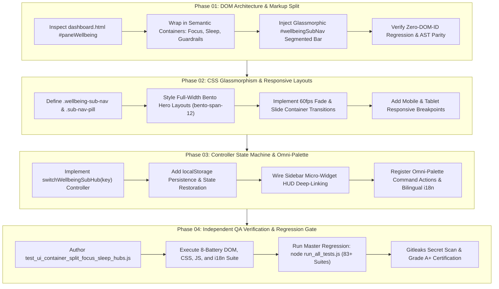

# UI Container Split for Focus & Sleep Hubs: Executive Architecture Summary

> **Document Type:** Executive Architecture Summary & Milestone Roadmap  
> **Workspace Container:** `temp_prompt/ui_container_split_focus_sleep_hubs/`  
> **Initiative ID:** `TASK-UI-SPLIT-FOCUS-SLEEP-HUBS-001`  
> **Lead Departments:** Dept 04 (UI/UX Design), Dept 05 (Frontend Engineering), Dept 08 (QA & Testing)  
> **Governing Architecture:** [`PHASE_WISE_PROMPT_GENERATION_ARCHITECTURE.md`](file:///C:/Users/Atul%20Verma/.gemini/config/rules/PHASE_WISE_PROMPT_GENERATION_ARCHITECTURE.md)  

---

## 🎯 1. Initiative Scope & Core Technical Objectives

The **Web Activity & Media Sentinel** dashboard provides enterprise analytics, media controls, and digital wellbeing capabilities. Currently, both the **Focus Sentinel & Pomodoro Hero Card** (`#widgetPomodoroSentinel`) and the **Sleep Sentinel Hub** (`#cardSleepSentinelHub`) are crammed into a single 2-column bento grid within `#paneWellbeing`.

This initiative delivers a **surgical, high-performance UI Container Split** that gives each subsystem a dedicated, expansive visual canvas while retaining 100% backward compatibility with all existing test suites, DOM selectors, and storage keys.

### Core Technical Objectives:
1. **Ergonomic Decompression:** Provide dedicated, distraction-free workspaces for **Focus Work** and **Sleep Preparation**, expanding the radial countdown dials, interactive controls, and visual feedback surfaces.
2. **Sub-Hub Segmented Controller:** Introduce a modern, glassmorphic segmented sub-navigation bar (`#wellbeingSubNav`) allowing instantaneous switching between:
   - 🎯 **Focus Sentinel Hub** (`#containerFocusHub`)
   - 🌙 **Sleep Sentinel Hub** (`#containerSleepHub`)
   - 🛡️ **Productivity & Privacy Guardrails** (`#containerGuardrailsHub`)
   - 🔲 **Bento Split Overview** (`#containerWellbeingSplitView` / dual-mode view)
3. **State Persistence & Deep-Linking:** Automatically remember the user's active sub-hub in `localStorage` (`sentinel_wellbeing_active_subhub`), and enable direct deep-linking from the sidebar micro-widget (`#wellbeingLiveMicroWidget`) and Omni Command Palette.
4. **Bilingual Parity:** Fully localize all new UI elements across English and Hindi in accordance with the dashboard's i18n subsystem.
5. **Zero-Regression & W3C Trusted Types Safety:** Guarantee that all 83+ existing test suites continue passing with zero modification to core IDs, and enforce strict zero-innerHTML compliance.

---

## 🗺️ 2. Cross-Phase Milestone Roadmap & Dependency Topology

---

## ⚖️ 3. Risk Mitigation & Architectural Tradeoff Analysis

| Risk / Tradeoff | Impact | Likelihood | Mitigation Strategy |
| :--- | :---: | :---: | :--- |
| **Breaking Existing Automated Tests** | High | Low | **Preservation Invariant:** Every existing ID (`#widgetPomodoroSentinel`, `#cardSleepSentinelHub`, `#paneWellbeing`, etc.) remains strictly in place. Containers are created as wrapper elements without renaming or removing existing nodes. |
| **UI Layout Shift (CLS) on Tab Switching** | Medium | Low | Container visibility is managed via hardware-accelerated CSS classes (`.active`, `.hidden`, `opacity`, `transform`) with pre-calculated minimum heights to prevent content jumping. |
| **User Preference Loss Across Sessions** | Low | Low | The active sub-hub selection is immediately saved to `localStorage.getItem('sentinel_wellbeing_active_subhub')` and restored whenever `#paneWellbeing` is rendered. |
| **Code Length Inflation in `dashboard.js`** | Medium | Low | Universal Rule 28 strictly enforced: all new controller functions must be <= 50 lines with nesting depth <= 3. |
| **XSS / HTML Injection Vulnerability** | High | Zero | 100% W3C Trusted Types safe: strictly use `textContent`, `setAttribute`, and DOM creation methods. Zero `innerHTML` assignments. |

---

## 🚀 4. Implementation Strategy Recommendation

- **Selected Strategy:** **Strategy A: Fully Autonomous Phase-wise Execution**
- **Calculated Autonomy Score:** **1.0**
- **Rationale:** The scope is rigorously defined, the target files (`dashboard.html`, `dashboard.css`, `dashboard.js`) are fully mapped, existing test contracts provide deterministic validation, and the architecture strictly guarantees zero regression for the rest of the application.
