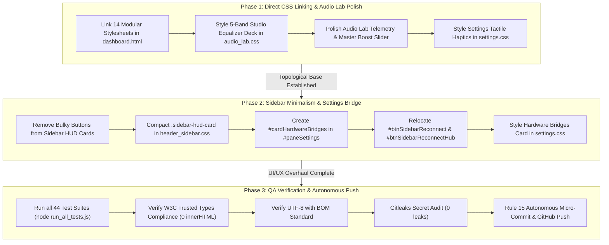

# Executive Architecture Summary: UI/UX & CSS Linking, 5-Band Equalizer & Audio Lab Styling, Tactile Audio Haptics in Settings, Sidebar Status Minimalism & Action Controls Shift to Settings

> **Workspace:** `temp_prompt/ui_ux_audio_sidebar_polish/`  
> **Target Project:** Web Activity & Media Sentinel (Chrome MV3 Browser Extension)  
> **Author:** Level 3C Phase-wise Prompt Generation Specialist  
> **Governance:** [`PHASE_WISE_PROMPT_GENERATION_ARCHITECTURE.md`](file:///C:/Users/Atul%20Verma/.gemini/config/rules/PHASE_WISE_PROMPT_GENERATION_ARCHITECTURE.md)  
> **Strategy:** Strategy A (Fully Autonomous Phase-wise Execution, Target Autonomy Score: 1.0)  

---

## 🏛️ 1. Executive Summary & Initiative Scope

The **Web Activity & Media Sentinel** dashboard serves as the central command console for real-time browsing analytics, media playback telemetry, and digital wellbeing governance. Following the successful completion of the Universal Modular Feature Registry overhaul, this initiative targets critical UI/UX refinements across four key fronts:

1. **Direct CSS Linking Architecture:** Transitioning from reliance on `@import` CSS cascade rules to direct, topological `<link rel="stylesheet">` tags in `dashboard/dashboard.html` `<head>`, eliminating stylesheet waterfall latency and enabling parallel asset fetching.
2. **5-Band Equalizer & Audio Lab Studio Deck Styling:** Elevating the dedicated 5-Band Graphic Equalizer (`#heroAudioEqCard`) and Audio Lab DSP Telemetry widget (`#heroAudioLabStatus`) in the Media Analytics tab to audiophile studio deck standards, featuring high-precision vertical sliders, illuminated decibel readouts, a zero-dB center detent horizon line, and responsive Liquid Glass 2.0 aesthetics.
3. **Tactile Audio Haptics Polish in Settings:** Providing complete, dedicated styling for the tactile audio feedback controls in Card 1.8 (`#cardAppearanceSettings`), including styled range sliders, real-time volume badges, and interactive chime test buttons.
4. **Sidebar HUD Minimalism & Hardware Bridges Relocation:** Decluttering the navigation sidebar by stripping out bulky reconnect buttons from the telemetry cards (`.sidebar-hud-card`), and re-housing those action controls (`#btnSidebarReconnectHub` and `#btnSidebarReconnect`) inside a newly crafted "Local Services & Hardware Bridges" card (`#cardHardwareBridges`) in the Settings tab (`#paneSettings`), strictly preserving 100% of DOM IDs to prevent JavaScript binding regressions.

---

## 🎯 2. Technical Objectives & Success Criteria

- **O-01 (CSS Architecture):** All 14 modular stylesheets in `dashboard/styles/` are directly linked in `dashboard/dashboard.html` in strict topological order before `dashboard.css`, ensuring zero FOUC and high-speed parallel stylesheet rendering.
- **O-02 (Equalizer Studio Deck):** `#heroAudioEqCard` and its 5 frequency band sliders (60Hz, 250Hz, 1kHz, 4kHz, 16kHz) exhibit pixel-perfect vertical slider tracks, glowing emerald/cyan neon thumbs, centered 0dB detent markers, and responsive layouts across viewport widths.
- **O-03 (Audio Lab Telemetry):** Master Volume Boost slider (0% to 200%), Vocal Clarity, Night Mode, and Audio-Only toggles feature cohesive Liquid Glass 2.0 cards, active status badges, and clear visual state distinctions.
- **O-04 (Settings Tactile Haptics):** Card 1.8 in `#paneSettings` showcases a bespoke tactile audio feedback control section with smooth sliding volume control, percentage readouts, and a feedback chime button.
- **O-05 (Sidebar HUD Minimalism):** Sidebar HUD cards are transformed into sleek, compact telemetry displays with pulsing LED status dots, service names, and port addresses, with bulky buttons eliminated from the sidebar.
- **O-06 (Hardware Bridges Relocation):** `#paneSettings` features a high-tech "Local Services & Hardware Bridges" card hosting `#btnSidebarReconnectHub` (SQLite Data Hub, port 65433 WAL) and `#btnSidebarReconnect` (Video Detector HUD, port 65432), preserving all DOM IDs and full event listener functionality.
- **O-07 (Quality & Security Gate):** All 44 test suites pass cleanly with exit code 0; zero `.innerHTML` assignments in all modified code; 100% UTF-8 with BOM; zero secret leaks in `gitleaks detect`.

---

## 🗺️ 3. Cross-Phase Milestone Roadmap & Dependency Topology

---

## 🛡️ 4. Risk Mitigation & Architectural Tradeoff Analysis

### 4.1 Strict DOM ID Preservation Contract
- **Risk:** Relocating `#btnSidebarReconnectHub` and `#btnSidebarReconnect` from the sidebar to `#paneSettings` could break existing click handlers in `dashboard/dashboard.js` (lines 3454, 5299, 6174, 6324).
- **Mitigation:** The relocation preserves the **EXACT DOM IDs** (`id="btnSidebarReconnectHub"` and `id="btnSidebarReconnect"`). No rename, wrapping, or duplication is introduced. The existing event listener attachments in `dashboard.js` continue to bind to these exact IDs without requiring any code mutation in `dashboard.js`.

### 4.2 CSS Cascade & Specificity Invariants
- **Risk:** Directly linking modular CSS files in `dashboard.html` might cause CSS specificity conflicts with `dashboard.css`.
- **Mitigation:** The `<link>` tags in `dashboard.html` are ordered strictly in topological dependency order (`tokens.css` -> `themes.css` -> `layout.css` -> `components.css` -> ... -> `wellbeing_blacklist.css`), with `dashboard.css` loaded **last** as the overarching master stylesheet. Furthermore, `@import` statements inside `dashboard.css` are maintained for backward compatibility with isolated test runners.

### 4.3 Zero `.innerHTML` Invariant (W3C Trusted Types Safety)
- **Risk:** New HTML elements introduced for `#cardHardwareBridges` might inadvertently introduce unsafe dynamic HTML string concatenation.
- **Mitigation:** All structural modifications to `dashboard.html` are statically authored in HTML. All dynamic UI updates continue to use `textContent`, `setAttribute`, `classList`, or safe DOM element creation, maintaining 100% compliance with Chrome MV3 security policies and `test_dashboard_full_audio_lab_parity.js`.

### 4.4 Backward Compatibility with Test Suites
- **Risk:** Relocating sidebar elements or modifying CSS links might trip assertions in the 44 existing test suites.
- **Mitigation:** Pre-flight inspection of `tests/` confirmed:
  - `tests/test_dashboard_multi_browser_filter.js` verifies `id="dataHubSidebarDot"` exists in `dashboard.html` (preserved).
  - `tests/test_dashboard_full_audio_lab_parity.js` verifies `id="heroAudioEqCard"`, `id="heroAudioLabStatus"`, `id="eqBand60"`..`eqBand16000`, `id="eqVal60"`..`eqVal16000`, and `id="audioLabPresetBadge"` (all preserved).
  - All 44 test suites are run locally before and after every phase to guarantee zero regressions.
