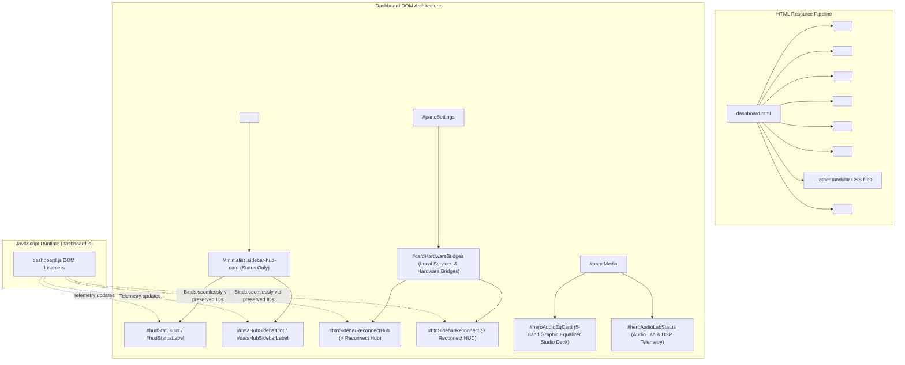

# Technical Requirements Document (TRD): UI/UX & CSS Linking, 5-Band Equalizer & Audio Lab Styling, Tactile Audio Haptics in Settings, Sidebar Status Minimalism & Action Controls Shift to Settings

> **Workspace:** `temp_prompt/ui_ux_audio_sidebar_polish/`  
> **Target Project:** Web Activity & Media Sentinel (Chrome MV3 Browser Extension)  
> **Author:** Level 3C Phase-wise Prompt Generation Specialist  
> **Lead Department:** Dept 05 Frontend Engineering & Dept 08 QA & Testing  
> **Governance:** [`PHASE_WISE_PROMPT_GENERATION_ARCHITECTURE.md`](file:///C:/Users/Atul%20Verma/.gemini/config/rules/PHASE_WISE_PROMPT_GENERATION_ARCHITECTURE.md)  

---

## 🏗️ 1. High-Level Design (HLD) & Architectural Overview

The architectural enhancements span three primary layers:
1. **HTML & Resource Linking Layer (`dashboard/dashboard.html`):** Restructuring the `<head>` resource loading pipeline from a waterfall `@import` model to a parallel `<link rel="stylesheet">` topological model, while refactoring DOM element locations to optimize user interaction hierarchies.
2. **Modular CSS Styling Layer (`dashboard/styles/*` & `dashboard/dashboard.css`):** Injecting studio-grade Liquid Glass 2.0 component styles into domain-specific stylesheets (`audio_lab.css`, `settings.css`, `layout/header_sidebar.css`) and preserving aggregate parity in `dashboard.css`.
3. **Runtime & Event Binding Integrity Layer (`dashboard/dashboard.js` & Test Suite):** Safeguarding all existing DOM element IDs, event listeners, and data-flow pipelines against regressions, guaranteeing 100% compliance with Chrome MV3 Content Security Policy (CSP) and W3C Trusted Types.



---

## 🔒 2. DOM Tree Preservation Contracts

Under no circumstances may any existing DOM ID or test-monitored element attribute be modified, renamed, or deleted. The following table codifies the non-negotiable DOM contracts:

| DOM ID / Selector | Required Attributes & Classes | Required Parent Container | Event Handlers / Listeners Bound | Monitored by Test File |
| :--- | :--- | :--- | :--- | :--- |
| `#dataHubSidebarDot` | `class="hud-dot offline"` | `.sidebar-hud-card` in sidebar | Telemetry state updates in `dashboard.js` | `test_dashboard_multi_browser_filter.js` |
| `#dataHubSidebarLabel` | `class="hud-status-text"` | `.sidebar-hud-card` in sidebar | Text updates in `dashboard.js` | `dashboard.js` |
| `#hudStatusDot` | `class="hud-dot offline"` | `.sidebar-hud-card` in sidebar | Telemetry state updates in `dashboard.js` | `dashboard.js` |
| `#hudStatusLabel` | `class="hud-status-text"` | `.sidebar-hud-card` in sidebar | Text updates in `dashboard.js` | `dashboard.js` |
| `#btnSidebarReconnectHub` | `class="btn-hud-reconnect"`, `title="Reconnect to SQLite Data Hub"` | Relocated to `#cardHardwareBridges` in `#paneSettings` | Click handler (lines 5299, 6174 in `dashboard.js`) | `dashboard.js` |
| `#btnSidebarReconnect` | `class="btn-hud-reconnect"`, `title="Reconnect to HUD"` | Relocated to `#cardHardwareBridges` in `#paneSettings` | Click handler (lines 3454, 6324 in `dashboard.js`) | `dashboard.js` |
| `#heroAudioEqCard` | `class="audio-eq-widget glass-card bento-card liquid-glass-card bento-span-12"` | `#paneMedia` (independent Bento deck) | Presets & reset events | `test_dashboard_full_audio_lab_parity.js` |
| `#heroAudioLabStatus` | `class="audio-lab-widget glass-card bento-card liquid-glass-card bento-span-4 bento-row-span-2"` | `#paneMedia` | Master boost & enhancements | `test_dashboard_full_audio_lab_parity.js` |
| `#eqBand60`..`#eqBand16000` | `min="-12" max="12" step="1" orient="vertical" class="eq-vertical-slider" role="slider"` | `#heroAudioEqCard` | Sliders & Web Audio BiquadFilter | `test_dashboard_full_audio_lab_parity.js` |
| `#eqVal60`..`#eqVal16000` | `class="eq-db-val"` | `#heroAudioEqCard` | Decibel text updates | `test_dashboard_full_audio_lab_parity.js` |
| `#audioLabPresetBadge` | `class="badge badge-preset"` | `#heroAudioLabStatus` | Preset label updates | `test_dashboard_full_audio_lab_parity.js` |
| `#audioLabVocalBadge` | `class="badge badge-feature"` | `#heroAudioLabStatus` | Vocal clarity toggle updates | `test_dashboard_full_audio_lab_parity.js` |
| `#audioLabNightBadge` | `class="badge badge-feature"` | `#heroAudioLabStatus` | Night mode toggle updates | `test_dashboard_full_audio_lab_parity.js` |
| `#audioLabStatusText` | Text status container | `#heroAudioLabStatus` | Audio telemetry updates | `test_dashboard_full_audio_lab_parity.js` |
| `#toggleAudioHaptics` | `type="checkbox"` | `#cardAppearanceSettings` in `#paneSettings` | Audio feedback toggle | `dashboard.js` |
| `#sliderAudioHapticsVolume`| `type="range" min="0" max="1" step="0.01" class="styled-range-slider"` | `#cardAppearanceSettings` in `#paneSettings` | Haptic volume input | `dashboard.js` |
| `#lblAudioHapticsVolumeValue`| `class="volume-badge"` | `#cardAppearanceSettings` in `#paneSettings` | Percentage text updates | `dashboard.js` |
| `#btnTestAudioHaptics` | `type="button" class="btn-test-chime"` | `#cardAppearanceSettings` in `#paneSettings` | Click handler (plays chime) | `dashboard.js` |

---

## 🎨 3. CSS Architecture & Cascade Hierarchy

### 3.1 Strict Topological Linking Order in `dashboard.html`
To prevent CSS cascade conflicts and eliminate `@import` waterfalls, `dashboard/dashboard.html` `<head>` must include `<link>` tags in the following deterministic sequence:

```html
<!-- Design Tokens & Themes (Foundational Variables) -->
<link rel="stylesheet" href="styles/tokens.css">
<link rel="stylesheet" href="styles/themes.css">
<link rel="stylesheet" href="styles/palette.css">

<!-- Core Layout & Common Components -->
<link rel="stylesheet" href="styles/layout.css">
<link rel="stylesheet" href="styles/layout/header_sidebar.css">
<link rel="stylesheet" href="styles/layout/bento_grid.css">
<link rel="stylesheet" href="styles/layout/responsive.css">
<link rel="stylesheet" href="styles/components.css">

<!-- Feature-Specific Modular Styles -->
<link rel="stylesheet" href="styles/metrics.css">
<link rel="stylesheet" href="styles/tracking.css">
<link rel="stylesheet" href="styles/media.css">
<link rel="stylesheet" href="styles/media/hero_player.css">
<link rel="stylesheet" href="styles/media/scrubber_controls.css">
<link rel="stylesheet" href="styles/audio_lab.css">
<link rel="stylesheet" href="styles/settings.css">
<link rel="stylesheet" href="styles/hotkeys.css">
<link rel="stylesheet" href="styles/backup_digest.css">
<link rel="stylesheet" href="styles/wellbeing_blacklist.css">

<!-- Master Aggregate Stylesheet (Overrides & Root Parity) -->
<link rel="stylesheet" href="dashboard.css">
```

### 3.2 Dual Loading Resilience
- `dashboard.css` retains its `@import` statements for all modular files. This guarantees that standalone tools, test harnesses, or sub-components importing `dashboard.css` directly continue to receive all modular styling without breakage.
- When loaded via `dashboard.html`, the browser encounters the `<link>` tags first, parsing modular sheets concurrently with high parallelism.

---

## 🛠️ 4. Low-Level Design (LLD): Component Specifications

### 4.1 5-Band Studio Graphic Equalizer Deck (`.audio-eq-widget`)
- **Container:** `.audio-eq-widget` styled as an expansive Bento deck (`.bento-span-12`), with glassmorphic backing:
  - `background: var(--glass-surface-bg, rgba(19, 25, 38, 0.75))`
  - `border: 1px solid var(--glass-specular-border, rgba(255, 255, 255, 0.08))`
  - `backdrop-filter: blur(24px)`
- **Sliders Grid:** `.eq-bands-grid` (5 columns, `grid-template-columns: repeat(5, 1fr)`) with a centered zero-dB detent horizon line:
  - `.eq-bands-grid::before` pseudo-element positioned at 50% height with a glowing emerald linear gradient (`rgba(16, 185, 129, 0.4)`).
- **Vertical Slider Inputs:**
  - Standardized cross-browser styling for `-webkit-appearance: slider-vertical`, `writing-mode: vertical-lr`, `direction: rtl`.
  - Dimensions: `width: 32px`, `height: 180px`.
  - WebKit Slider Thumb: `width: 24px`, `height: 14px`, `border-radius: 4px`, `background: var(--accent-emerald, #10b981)`, `box-shadow: 0 0 10px rgba(16, 185, 129, 0.7)`.
  - Active thumb hover: `box-shadow: 0 0 16px rgba(16, 185, 129, 0.9)`, `transform: scale(1.1)`.
- **Decibel Value Badge:** `.eq-db-val` displaying tabular numbers with monospace font, glowing emerald borders, and active tint when non-zero.

### 4.2 Audio Lab Telemetry & Master Boost Slider
- **Container:** `.audio-lab-widget` with `.bento-span-4 .bento-row-span-2` grid placement.
- **Master Boost Slider:** `#heroAudioBoostSlider` spanning 0% to 200%:
  - Track background with dynamic gradient indication.
  - Scale markers for 0%, 50%, 100% (Normal - emerald), 150%, 200% (Max - amber/orange).
  - WebKit thumb styled with emerald glow (`#10b981`).
- **Feature Badges:** Distinct colorways for active vs idle states (`.badge-preset` in cyan `#06b6d4`, `.badge-feature.badge-active` in emerald `#10b981`).

### 4.3 Settings Tactile Audio Feedback Controls
- **Location:** Card 1.8 (`#cardAppearanceSettings`) in `#paneSettings`.
- **Control Layout:** `.haptic-volume-control` flexbox container:
  - `#sliderAudioHapticsVolume`: Custom styled range slider with sleek track (`height: 6px`, `border-radius: 3px`) and illuminated circular thumb (`18px x 18px`, `background: var(--accent-cyan, #06b6d4)`).
  - `#lblAudioHapticsVolumeValue`: Monospace percentage badge (`.volume-badge`) with cyan glow.
  - `#btnTestAudioHaptics`: Action button (`.btn-test-chime`) with Liquid Glass border, bell icon, and subtle hover scale effect.

### 4.4 Minimalist Sidebar HUD Cards
- **Location:** `.sidebar-hud-card` in `dashboard/dashboard.html`.
- **Modifications:** Remove `<button id="btnSidebarReconnectHub" ...>` and `<button id="btnSidebarReconnect" ...>` from the sidebar.
- **Preserved Structure:**
  ```html
  <div class="sidebar-hud-card">
    <div class="hud-card-header">
      <span class="hud-card-title">SQLite Data Hub</span>
      <span id="dataHubSidebarDot" class="hud-dot offline"></span>
    </div>
    <div class="hud-card-body">
      <span id="dataHubSidebarLabel" class="hud-status-text">Hub Offline</span>
      <span class="hud-address">ws://127.0.0.1:65433 (WAL)</span>
    </div>
  </div>
  ```
- **Styling:** Compact vertical padding (`0.75rem 0.85rem`), micro-typography for address labels (`10.5px`), and glowing LED status dots.

### 4.5 Local Services & Hardware Bridges Card in `#paneSettings`
- **Location:** Inside `#paneSettings` bento grid container (`#tabContentSettings`).
- **DOM Specification:**
  ```html
  <!-- Card: Local Services & Hardware Bridges -->
  <div id="cardHardwareBridges" class="settings-card bento-card liquid-glass-card bento-span-6 settings-section-card">
    <div class="settings-card-header">
      <span class="settings-card-icon">🔌</span>
      <div class="settings-card-title-group">
        <h3 id="headingHardwareBridges" class="settings-card-title">Local Services & Hardware Bridges</h3>
        <span id="subHardwareBridges" class="settings-card-sub">WebSocket daemons, SQLite storage engine, and peripheral telemetry</span>
      </div>
    </div>
    <div class="settings-card-body">
      <!-- Service 1: SQLite Data Hub -->
      <div class="bridge-service-row">
        <div class="bridge-service-meta">
          <div class="bridge-service-name-wrap">
            <span class="bridge-service-icon">💾</span>
            <span class="bridge-service-name">SQLite Data Hub Daemon</span>
            <span class="bridge-port-badge">Port 65433 (WAL)</span>
          </div>
          <span class="bridge-service-desc">Local high-concurrency event telemetry & persistent database store</span>
        </div>
        <button id="btnSidebarReconnectHub" class="btn-hud-reconnect btn-bridge-action" title="Reconnect to SQLite Data Hub">
          ⚡ Reconnect Hub
        </button>
      </div>

      <!-- Service 2: Video Detector HUD -->
      <div class="bridge-service-row">
        <div class="bridge-service-meta">
          <div class="bridge-service-name-wrap">
            <span class="bridge-service-icon">🖥️</span>
            <span class="bridge-service-name">Video Detector HUD Bridge</span>
            <span class="bridge-port-badge">Port 65432</span>
          </div>
          <span class="bridge-service-desc">Real-time overlay bridge for Windows desktop video sentinel</span>
        </div>
        <button id="btnSidebarReconnect" class="btn-hud-reconnect btn-bridge-action" title="Reconnect to HUD">
          ⚡ Reconnect HUD
        </button>
      </div>
    </div>
  </div>
  ```

---

## 🔒 5. Security & Content Security Policy (CSP)

- **Zero Inline Event Handlers:** No element in `dashboard.html` or generated DOM can declare `onclick`, `onchange`, `oninput`, or `javascript:` URLs. All listeners are bound unobtrusively in JavaScript.
- **W3C Trusted Types Compliance:** Zero assignments to `innerHTML`, `outerHTML`, or `document.write`. All dynamic updates must use `textContent`, `setAttribute`, or safe DOM nodes.
- **Chrome MV3 Isolation:** CSS resources are declared locally via relative paths (`styles/*.css`). No remote external CDNs or unapproved fonts are loaded.

---

## ⚠️ 6. Error Budgets & Failure Modes

| Failure Scenario | Immediate Detection | Root Cause Prevention | Containment & Recovery |
| :--- | :--- | :--- | :--- |
| Broken JavaScript event binding | Button click does nothing; test fails | Exact DOM IDs (`btnSidebarReconnectHub`, `btnSidebarReconnect`) strictly preserved | Revert DOM ID mutations; ensure ID exists prior to `dashboard.js` execution |
| Stylesheet 404 / path error | Unstyled component or console error | Exact relative path mapping matching `dashboard/styles/` directory | Verify file paths via test harness and AST checks |
| Decibel slider visual clipping | Sliders overflow on small viewports | Responsive grid with `min-width: 0` and media queries in `audio_lab.css` | Test across viewports down to 1024px |
| Light theme contrast degradation | Text unreadable on white backgrounds | Explicit light-theme tokens in `themes.css` and `dashboard.css` | Contrast ratio verification (>= 4.5:1) |
