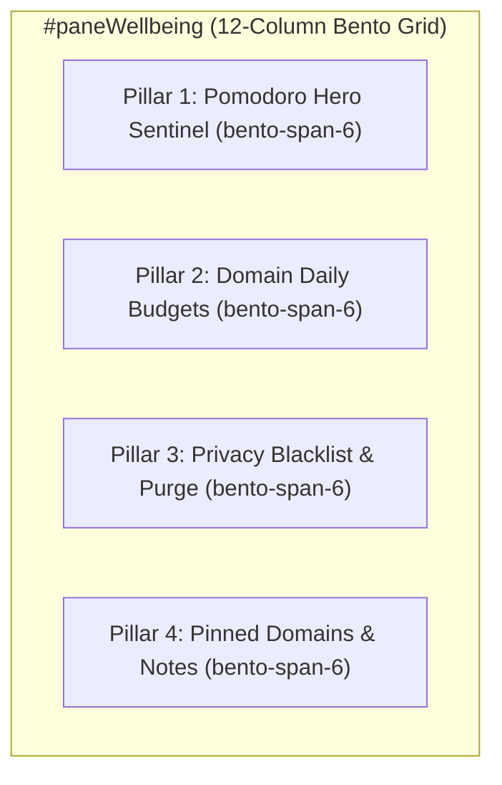

# Design System & UI Specification (DESIGN.md) - UI/UX Restoration v4
# डिज़ाइन सिस्टम एवं सौंदर्य विनिर्देश: Liquid Glass 2.0 & सिमेट्रिकल बेंटो ग्रिड

> **सिस्टम (Design System):** iOS 26 Liquid Glass 2.0 & Bento Grid Architecture  
> **लक्षित उत्पाद (Target Product):** Web Activity & Media Sentinel Dashboard  
> **अग्रणी वास्तुकार (Lead Architect):** Atul Verma (`aiprincekumar` / `aiprincekumar010100@gmail.com`)  
> **दस्तावेज़ संस्करण (Version):** 4.0.0  
> **कंटेनर पाथ (Container):** [`temp_prompt/ui_ux_restoration_v4/DESIGN.md`](file:///c:/Users/Atul%20Verma/Desktop/Win%20App%20Tracker/Browser%20Detection/temp_prompt/ui_ux_restoration_v4/DESIGN.md)  
> **स्थिति (Status):** APPROVED DESIGN CONSTITUTION

---

## 💎 1. Liquid Glass 2.0 टोकन संविधान (Semantic Design Tokens)

```css
:root {
  /* Surfaces & Glassmorphism */
  --glass-surface-bg: rgba(15, 23, 42, 0.70);
  --glass-surface-hover: rgba(30, 41, 59, 0.85);
  --glass-surface-elevated: rgba(30, 41, 59, 0.95);
  --glass-border: rgba(255, 255, 255, 0.10);
  --glass-border-focus: rgba(16, 185, 129, 0.55);
  --glass-specular-highlight: inset 0 1px 0 rgba(255, 255, 255, 0.15);
  --glass-card-shadow: 0 12px 32px 0 rgba(0, 0, 0, 0.35);
  
  /* Optical Filters */
  --glass-backdrop-blur: blur(24px);
  --glass-saturation: saturate(190%);

  /* Primary Typography Scales */
  --font-family-sans: -apple-system, BlinkMacSystemFont, 'SF Pro Display', 'Inter', system-ui, sans-serif;
  --font-family-mono: 'SF Mono', 'JetBrains Mono', 'Fira Code', ui-monospace, monospace;

  /* Accent Glow Palette */
  --accent-emerald: #10b981;
  --accent-cyan: #06b6d4;
  --accent-violet: #8b5cf6;
  --accent-rose: #f43f5e;
  --accent-amber: #f59e0b;

  /* Z-Index Strata */
  --z-sidebar: 50;
  --z-topbar: 40;
  --z-dropdown: 1000;
  --z-popover: 1100;
  --z-modal: 2000;
  --z-toast: 3000;
}

/* Light Mode Calibration */
body.theme-light {
  --glass-surface-bg: rgba(255, 255, 255, 0.75);
  --glass-surface-hover: rgba(241, 245, 249, 0.90);
  --glass-surface-elevated: rgba(255, 255, 255, 0.96);
  --glass-border: rgba(0, 0, 0, 0.08);
  --glass-border-focus: rgba(16, 185, 129, 0.65);
  --glass-specular-highlight: inset 0 1px 0 rgba(255, 255, 255, 0.8);
  --glass-card-shadow: 0 12px 32px 0 rgba(0, 0, 0, 0.08);
}
```

---

## 🔘 2. शीर्ष ऐप बार एवं आइकन-ओनली बटन विनिर्देश (Header Icon-Only Buttons)

शीर्ष पट्टी में टेक्स्ट की भीड़ को समाप्त करने के लिए सभी बटन 36px x 36px के गोलाकार/चौकोर ग्लासी पैड में संकुचित होंगे:

```css
.btn-action-icon-only {
  display: inline-flex;
  align-items: center;
  justify-content: center;
  width: 36px;
  height: 36px;
  min-width: 36px;
  padding: 0;
  background: var(--glass-surface-bg);
  backdrop-filter: var(--glass-backdrop-blur);
  -webkit-backdrop-filter: var(--glass-backdrop-blur);
  border: 1px solid var(--glass-border);
  box-shadow: var(--glass-specular-highlight);
  border-radius: 10px;
  color: var(--text-primary);
  font-size: 15px;
  cursor: pointer;
  position: relative;
  transition: transform 0.18s cubic-bezier(0.34, 1.56, 0.64, 1),
              background-color 0.18s ease,
              border-color 0.18s ease,
              box-shadow 0.18s ease;
}

.btn-action-icon-only:hover {
  transform: translateY(-1.5px) scale(1.05);
  background: var(--glass-surface-hover);
  border-color: rgba(255, 255, 255, 0.22);
  box-shadow: 0 4px 12px rgba(0, 0, 0, 0.25), var(--glass-specular-highlight);
}

.btn-action-icon-only:active {
  transform: translateY(0.5px) scale(0.96);
}

.btn-action-icon-only:focus-visible {
  outline: none;
  border-color: var(--glass-border-focus);
  box-shadow: 0 0 0 3px rgba(16, 185, 129, 0.25);
}

/* Screen-reader accessible hidden text */
.sr-only {
  position: absolute;
  width: 1px;
  height: 1px;
  padding: 0;
  margin: -1px;
  overflow: hidden;
  clip: rect(0, 0, 0, 0);
  white-space: nowrap;
  border: 0;
}

/* Glassmorphic Dropdown Chevron */
.dropdown-chevron-micro {
  font-size: 10px;
  opacity: 0.6;
  margin-left: 2px;
}
```

---

## 🎛️ 3. मीडिया प्लेयर स्लाइडर सममिति (Media Slider Symmetrical Geometry)

वीडियो टाइमलाइन और वॉल्यूम बार दोनों को एकसमान ग्रिड संरेखण में प्रस्तुत किया जाएगा:

```css
/* Progress & Volume Slider Harmonization */
.hero-progress-section,
.hero-volume-section {
  width: 100%;
  display: flex;
  align-items: center;
  gap: 14px;
}

.hero-progress-track,
.hero-volume-track {
  flex: 1;
  width: 100%;
  height: 6px;
  background: rgba(255, 255, 255, 0.12);
  border-radius: 9999px;
  position: relative;
  cursor: pointer;
  transition: height 180ms cubic-bezier(0.16, 1, 0.3, 1), background-color 180ms ease;
}

.hero-progress-track:hover,
.hero-volume-track:hover,
.hero-progress-track.dragging,
.hero-volume-track.dragging {
  height: 8px;
  background: rgba(255, 255, 255, 0.18);
}

/* Floating Glass Tooltips */
.scrubber-floating-tooltip,
.vol-floating-tooltip {
  position: absolute;
  bottom: calc(100% + 8px);
  transform: translateX(-50%);
  background: rgba(15, 23, 42, 0.92);
  backdrop-filter: blur(16px);
  -webkit-backdrop-filter: blur(16px);
  border: 1px solid rgba(255, 255, 255, 0.15);
  border-radius: 6px;
  padding: 3px 8px;
  font-size: 11px;
  font-family: var(--font-family-mono);
  font-weight: 600;
  color: #f8fafc;
  box-shadow: 0 4px 14px rgba(0, 0, 0, 0.35);
  pointer-events: none;
  white-space: nowrap;
}
```

---

## 🧘 4. चतुर्थ टैब: फोकस व वेलबीइंग बेंटो ग्रिड लेआउट (4-Pillar Bento Grid)

चतुर्थ टैब 12-कॉलम बेंटो सिस्टम में 4 प्रमुख खंभों (Pillars) के रूप में विभाजित होगा:
- **Pillar 1 (`bento-span-6`):** पोमोडोरो हीरो कार्ड (घड़ी, सर्कुलर/लीनियर प्रोग्रेस, प्ले/पॉज़/रीसेट)।
- **Pillar 2 (`bento-span-6`):** दैनिक डोमेन बजट्स (इनपुट फॉर्म, मिनट स्लाइडर, और एक्टिव प्रोग्रेस बार्स)।
- **Pillar 3 (`bento-span-6`):** गोपनीयता बहिष्करण ब्लैकलिस्ट (पैटर्न इनपुट, रंगीन चिप्स, और रेट्रोएक्टिव पर्ज बटन)।
- **Pillar 4 (`bento-span-6`):** पिन किए गए पसंदीदा डोमेन व नोट्स (त्वरित स्टार अवलोकन व संपादन)।



---

## 🪟 5. Liquid Glass 2.0 मोडल डायलॉग विनिर्देश (Modal Architecture)

```css
/* Modal Backdrop & Liquid Glass Card */
.modal-backdrop {
  position: fixed;
  inset: 0;
  background: rgba(0, 0, 0, 0.65);
  backdrop-filter: blur(16px);
  -webkit-backdrop-filter: blur(16px);
  z-index: var(--z-modal);
  display: flex;
  align-items: center;
  justify-content: center;
  padding: 1.5rem;
  opacity: 1;
  transition: opacity 220ms ease;
}

.modal-backdrop.hidden {
  display: none !important;
  opacity: 0;
  pointer-events: none;
}

.modal-card.liquid-glass-card {
  width: 100%;
  max-width: 540px;
  background: var(--glass-surface-elevated);
  backdrop-filter: var(--glass-backdrop-blur);
  -webkit-backdrop-filter: var(--glass-backdrop-blur);
  border: 1px solid var(--glass-border);
  box-shadow: var(--glass-card-shadow), var(--glass-specular-highlight);
  border-radius: 18px;
  padding: 1.75rem;
  animation: modalScaleUp 220ms cubic-bezier(0.16, 1, 0.3, 1) forwards;
}

@keyframes modalScaleUp {
  from {
    opacity: 0;
    transform: scale(0.94) translateY(8px);
  }
  to {
    opacity: 1;
    transform: scale(1) translateY(0);
  }
}
```
