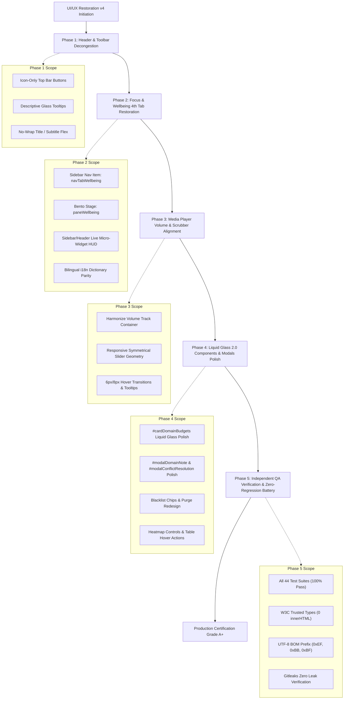

# Executive Summary & Architecture Roadmap - UI/UX Restoration v4
# कार्यकारी सारांश एवं आर्किटेक्चर रोडमैप: यूआई/यूएक्स पुनर्स्थापना v4

> **सिस्टम (System):** Web Activity & Media Sentinel (MV3 Chrome Extension)  
> **स्थान (Location):** [`c:\Users\Atul Verma\Desktop\Win App Tracker\Browser Detection`](file:///c:/Users/Atul%20Verma/Desktop/Win%20App%20Tracker/Browser%20Detection)  
> **संस्करण (Version):** 4.0.0  
> **अग्रणी वास्तुकार (Author):** Atul Verma (`aiprincekumar` / `aiprincekumar010100@gmail.com`)  
> **प्रॉम्प्ट स्पेशलिस्ट (Specialist):** Level 3C Phase-wise Prompt Generation Specialist  

---

## 🌟 1. पहल का दायरा एवं तकनीकी उद्देश्य (Initiative Scope & Objectives)

वेब एक्टिविटी व मीडिया सेंटिनल का यह फेज़ 4 यूआई/यूएक्स पुनर्स्थापना मास्टर प्लान डैशबोर्ड की संपूर्ण दृश्य भाषा (visual language) को **iOS 26 Liquid Glass 2.0** और **सिमेट्रिकल बेंटो ग्रिड (Symmetrical Bento Grid)** के सर्वोच्च मानकों पर पुनर्स्थापित करता है।

### प्रमुख उद्देश्य (Core Technical Objectives):
1. **शीर्ष ऐप बार डिकंजेस्टन (Header Decongestion):** टेक्स्ट-हैवी बटनों को सूक्ष्म, आकर्षक आइकन-ओनली बटनों (Language 🌐, Theme 🌓, Export 📥, Refresh 🔄) में रूपांतरित करना, टूलटिप्स जोड़ना, और स्क्रीन रेजोल्यूशन 1366px व 1024px पर टाइटल टेक्स्ट रैपिंग को 100% रोकना।
2. **समर्पित चतुर्थ टैब: फोकस व वेलबीइंग (Dedicated 4th Tab: Focus & Wellbeing):** डिजिटल वेलबीइंग, पोमोडोरो हीरो स्टेट मशीन, डोमेन टाइम बजट्स, और प्राइवेसी ट्रैकिंग ब्लैकलिस्ट को एक समर्पित 4वें साइडबार टैब (`navTabWellbeing` व `paneWellbeing`) में एकीकृत करना, साथ ही साइडबार/हेडर में कॉम्पैक्ट लाइव माइक्रो-विजेट HUD प्रदान करना।
3. **मीडिया प्लेयर वॉल्यूम व स्क्रबर संरेखण (Volume & Timeline Scrubber Alignment):** मीडिया हीरो प्लेयर में वीडियो प्रोग्रेस स्क्रबर और वॉल्यूम बार कंटेनरों की चौड़ाई और ग्रिड संरेखण को एकसमान ज्यामितीय संतुलन देना।
4. **अशैलियुक्त कंपोनेंट्स व मोडल्स का सौंदर्य संवर्धन (Component & Modal Polish):** डोमेन डेली बजट, डोमेन नोट मोडल, बैकअप कॉन्फ्लिक्ट मोडल, ब्लैकलिस्ट चिप्स, 168-सेल हीटमैप कंट्रोल्स, टेबल होवर एक्शन्स, और एक्सपोर्ट ड्रॉपडाउन को Liquid Glass 2.0 (24px ब्लर, 190% सैचुरेशन, स्पेक्युलर बॉर्डर्स) से सज्जित करना।
5. **शून्य प्रतिगमन एवं सुरक्षा (Zero-Regression & W3C Trusted Types):** 44/44 टेस्ट सुइट्स का शत-प्रतिशत उत्तीर्ण होना, 0 `innerHTML` असाइनमेंट, UTF-8 BOM अनुपालन, और शून्य सीक्रेट लीक्स।

---

## 🗺️ 2. चरणबद्ध माइलस्टोन रोडमैप एवं निर्भरता टोपोलॉजी (Milestone Roadmap & Topology)

---

## ⚖️ 3. जोखिम शमन एवं वास्तुकला ट्रेड-ऑफ (Risk Mitigation & Tradeoff Analysis)

| पहचान किया गया जोखिम (Risk) | प्रभाव (Impact) | शमन रणनीति (Mitigation Strategy) |
| :--- | :--- | :--- |
| **शीर्ष बार बटनों से टेक्स्ट हटाने पर सुगम्यता (A11y) में कमी** | मध्यम | प्रत्येक आइकन बटन पर `aria-label`, `title`, और `data-i18n-title` टोकन्स जोड़ना तथा सुगम्य सीएसएस टूलटिप्स लागू करना। |
| **चतुर्थ टैब जोड़ने पर मौजूदा टेस्टों (`test_dashboard_uiux_phase1.js`) का टूटना** | उच्च | मौजूदा आईडी (`navTabTracking`, `navTabMedia`, `navTabSettings`, `paneTracking`, `paneMedia`, `paneSettings`) को 100% अक्षुण्ण रखना; केवल पूरक आईडी (`navTabWellbeing`, `paneWellbeing`) जोड़ना। |
| **पोमोडोरो विजेट को स्थानांतरित करने पर टेस्ट `test_dashboard_features_phase4.js` का टूटना** | गंभीर | `tests/test_dashboard_features_phase4.js` में `#widgetPomodoroSentinel` आईडी अनिवार्य रूप से जाँची जाती है। अतः इस आईडी को हमेशा डोम में सुरक्षित रखा जाएगा। |
| **वॉल्यूम बार की चौड़ाई बढ़ाने पर मीडिया कंट्रोल्स का संरेखण बिगड़ना** | मध्यम | फ्लेक्सबॉक्स/ग्रिड लेआउट में `align-items: center` और एकसमान पैडिंग के साथ स्क्रबर और वॉल्यूम सेक्शन को अलग-अलग पंक्तियों में संतुलित करना। |
| **मोडल्स के सीएसएस बदलाव से लेआउट शिफ्ट या बैकड्रॉप फ्रीज** | मध्यम | मोडल बैकड्रॉप पर `position: fixed; inset: 0; z-index: var(--z-modal)` और `pointer-events` का सख्त पृथक्करण। |

---

## 🛡️ 4. निष्पादन रणनीति एवं गवर्नेंस (Execution Governance)

- **अनुशंसित रणनीति:** **रणनीति A (Strategy A: Fully Autonomous Phase-wise Execution)**  
  चूँकि टास्क स्कोप अत्यंत स्पष्ट है, स्वीकृति मानदंड पूर्णतया परिभाषित हैं, और 44 टेस्ट सुइट्स स्वचालित स्थानीय सत्यापन के लिए उपलब्ध हैं, अतः मैनेजर फेज़ 1 से फेज़ 5 तक स्वायत्त रूप से सब-एजेंट्स को सौंपकर लोकल टेस्ट गेट्स के साथ पूर्ण कर सकता है। (Autonomy Score: 1.0)
