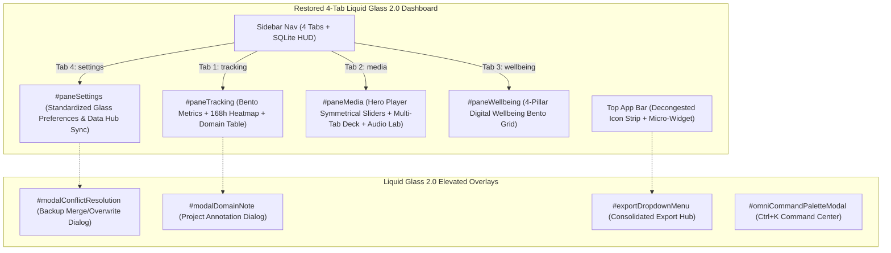

# Technical Requirements Document (TRD) - UI/UX Restoration v4
# तकनीकी आवश्यकता दस्तावेज़: यूआई/यूएक्स पुनर्स्थापना एवं आर्किटेक्चर विनिर्देश v4

> **सिस्टम (Target System):** Web Activity & Media Sentinel (Chrome MV3 Extension Dashboard)  
> **अग्रणी वास्तुकार (Lead Architect):** Atul Verma (`aiprincekumar` / `aiprincekumar010100@gmail.com`)  
> **दस्तावेज़ संस्करण (Version):** 4.0.0  
> **कंटेनर पाथ (Container):** [`temp_prompt/ui_ux_restoration_v4/TRD.md`](file:///c:/Users/Atul%20Verma/Desktop/Win%20App%20Tracker/Browser%20Detection/temp_prompt/ui_ux_restoration_v4/TRD.md)  
> **स्थिति (Status):** APPROVED TECHNICAL SPECIFICATION

---

## 🏛️ 1. उच्च-स्तरीय एवं निम्न-स्तरीय वास्तुकला (HLD & LLD Architecture)



---

## 📐 2. डीओएम संरचना अनुबंध (DOM Structure Target Contracts)

### 2.1 शीर्ष ऐप बार (Top App Bar Transformation)
- **पूर्व स्थिति (Current / Problematic):**
  बटनों में लंबे टेक्स्ट लेबल्स जैसे `<span id="langToggleText">English</span>`, `<span id="themeToggleText">Light</span>`, `<span id="btnExportMenuText">Export</span>`, `<span id="btnGlobalRefreshText">Refresh</span>` होने से 1366px चौड़ाई पर शीर्ष पट्टी 2 पंक्तियों में टूटती है।
- **लक्ष्य अनुबंध (Target Contract):**
```html
<header class="top-app-bar">
  <div class="app-bar-left">
    <h2 id="topBarTitle" class="current-page-title" data-i18n="title_tracking">⏱️ Time Tracking Analytics</h2>
    <span id="topBarSubtitle" class="current-page-subtitle" data-i18n="sub_tracking">Detailed breakdown of daily browsing time and website usage</span>
  </div>

  <div class="app-bar-right">
    <!-- Compact Multi-Browser Filter Selector -->
    <div class="browser-filter-container compact-pill" title="Filter analytics by browser">
      <span class="browser-filter-icon">🌐</span>
      <select id="browserFilterSelect" class="browser-filter-select" aria-label="Filter Analytics by Browser">
        <option value="all">🌐 All Browsers</option>
        <option value="chrome">Chrome</option>
        <option value="edge">Edge</option>
        <option value="brave">Brave</option>
        <option value="opera">Opera</option>
      </select>
    </div>

    <!-- Compact Dual/Triple Tracking Method Selector -->
    <div class="browser-filter-container tracking-filter-container compact-pill" title="Select Tracking Method: Combined / Active / BG Media">
      <span class="browser-filter-icon">📊</span>
      <select id="trackingModeSelect" class="browser-filter-select" aria-label="Select Tracking Method">
        <option value="all" selected>🌐 Combined</option>
        <option value="foreground">🖥️ Active Only</option>
        <option value="background_media">🎵 BG Media</option>
      </select>
    </div>

    <!-- Standalone SQLite Data Hub Status Badge -->
    <div id="dataHubBadge" class="datahub-status-badge offline" title="Standalone SQLite Data Hub (ws://127.0.0.1:65433) - Click to Reconnect">
      <span class="datahub-dot"></span>
      <span id="dataHubBadgeText">Hub Offline</span>
    </div>

    <!-- Live Clock Pill -->
    <div id="liveClockPill" class="live-clock-pill">
      <span class="clock-icon">🕒</span>
      <span id="liveClockText">--:--:--</span>
    </div>

    <!-- 1-Click Icon-Only Language Switcher -->
    <button id="btnLangToggle" class="btn-action-icon-only btn-lang-toggle" title="Switch Language (English / हिंदी)" aria-label="Switch Language (English / हिंदी)">
      <span class="lang-icon">🌐</span>
      <span id="langToggleText" class="sr-only">English</span>
    </button>

    <!-- 1-Click Icon-Only Theme Switcher -->
    <button id="btnThemeToggle" class="btn-action-icon-only topbar-btn btn-theme-toggle" title="Switch to Light Mode" aria-label="Switch to Light Mode" data-i18n-title="theme_toggle_light">
      <svg class="topbar-icon theme-toggle-icon" viewBox="0 0 24 24" fill="none" stroke="currentColor" stroke-width="2" stroke-linecap="round" stroke-linejoin="round">
        <circle cx="12" cy="12" r="5"></circle>
        <line x1="12" y1="1" x2="12" y2="3"></line>
        <line x1="12" y1="21" x2="12" y2="23"></line>
        <line x1="4.22" y1="4.22" x2="5.64" y2="5.64"></line>
        <line x1="18.36" y1="18.36" x2="19.78" y2="19.78"></line>
        <line x1="1" y1="12" x2="3" y2="12"></line>
        <line x1="21" y1="12" x2="23" y2="12"></line>
        <line x1="4.22" y1="19.78" x2="5.64" y2="18.36"></line>
        <line x1="18.36" y1="5.64" x2="19.78" y2="4.22"></line>
      </svg>
      <span id="themeToggleText" class="sr-only">Light</span>
    </button>

    <!-- Consolidated Export Dropdown Hub -->
    <div class="export-dropdown-container">
      <button type="button" id="btnExportMenu" class="btn-action-icon-only btn-export-trigger" aria-haspopup="true" aria-expanded="false" title="Export & Reports" aria-label="Export & Reports">
        <span class="action-btn-icon">📥</span>
        <span id="btnExportMenuText" class="sr-only">Export</span>
        <span class="dropdown-chevron-micro">▾</span>
      </button>
      <div id="exportDropdownMenu" class="export-dropdown-menu liquid-glass-card hidden" role="menu" aria-label="Export Formats">
        <button type="button" id="btnPrintPdf" class="export-menu-item" role="menuitem">
          <span class="menu-item-icon">🖨️</span>
          <div class="menu-item-info">
            <span class="menu-item-title" id="btnPrintPdfText">Save PDF Executive Digest</span>
            <span class="menu-item-desc">Print-optimized multi-page report</span>
          </div>
        </button>
        <button type="button" id="btnDownloadHtmlDigest" class="export-menu-item" role="menuitem">
          <span class="menu-item-icon">📄</span>
          <div class="menu-item-info">
            <span class="menu-item-title" id="btnDownloadHtmlDigestText">Offline HTML Report</span>
            <span class="menu-item-desc">Self-contained interactive dashboard</span>
          </div>
        </button>
        <div class="dropdown-divider"></div>
        <button type="button" id="btnExportTimeCsv" class="export-menu-item" role="menuitem">
          <span class="menu-item-icon">📊</span>
          <div class="menu-item-info">
            <span class="menu-item-title">Export Time Data (CSV)</span>
            <span class="menu-item-desc">RFC 4180 raw tabular records</span>
          </div>
        </button>
        <button type="button" id="btnExportMediaCsvMenu" class="export-menu-item" role="menuitem">
          <span class="menu-item-icon">🎬</span>
          <div class="menu-item-info">
            <span class="menu-item-title">Export Media History (CSV)</span>
            <span class="menu-item-desc">Full audio/video play records</span>
          </div>
        </button>
      </div>
    </div>

    <!-- 1-Click Icon-Only Refresh Button -->
    <button id="btnGlobalRefresh" class="btn-action-icon-only" title="Refresh Data" aria-label="Refresh Data">
      <span class="refresh-spinner-icon">🔄</span>
      <span id="btnGlobalRefreshText" class="sr-only">Refresh</span>
    </button>
  </div>
</header>
```

---

### 2.2 चतुर्थ साइडबार टैब एवं बेंटो स्टेज (Sidebar 4th Tab & Stage Target)
- **साइडबार नेविगेशन (Sidebar Navigation Contract):**
```html
<nav class="sidebar-nav" role="tablist">
  <button id="navTabTracking" class="nav-item active" data-tab="tracking" role="tab" aria-selected="true" aria-controls="paneTracking">
    <span class="nav-icon">⏱️</span>
    <span id="navTrackingText" class="nav-text">Time Tracking</span>
  </button>
  <button id="navTabMedia" class="nav-item" data-tab="media" role="tab" aria-selected="false" aria-controls="paneMedia">
    <span class="nav-icon">🎬</span>
    <span id="navMediaText" class="nav-text">Media Analytics</span>
    <span id="sidebarLiveDot" class="nav-live-dot hidden" title="Media Active"></span>
    <span id="sidebarLiveEqVisualizer" class="kinetic-eq-visualizer hidden" aria-hidden="true">
      <span class="eq-bar bar-1"></span>
      <span class="eq-bar bar-2"></span>
      <span class="eq-bar bar-3"></span>
    </span>
  </button>
  <!-- NEW RESTORED 4TH TAB -->
  <button id="navTabWellbeing" class="nav-item" data-tab="wellbeing" role="tab" aria-selected="false" aria-controls="paneWellbeing">
    <span class="nav-icon">🧘</span>
    <span id="navWellbeingText" class="nav-text">Focus & Wellbeing</span>
  </button>
  <button id="navTabSettings" class="nav-item" data-tab="settings" role="tab" aria-selected="false" aria-controls="paneSettings">
    <span class="nav-icon">⚙️</span>
    <span id="navSettingsText" class="nav-text">Settings & Data</span>
  </button>
</nav>
```

- **चतुर्थ स्टेज पैनल (#paneWellbeing Contract):**
```html
<section id="paneWellbeing" class="tab-pane" role="tabpanel" aria-labelledby="navTabWellbeing">
  <div class="bento-grid">
    <!-- Pillar 1: Hero Pomodoro Sentinel State Machine Card (Preserves id="widgetPomodoroSentinel") -->
    <div id="widgetPomodoroSentinel" class="bento-card liquid-glass-card bento-span-6 pomodoro-hero-card">
      <div class="card-header-row">
        <div class="card-title-group">
          <span class="card-icon">🧘</span>
          <h3 id="txtPomodoroTitle" class="card-heading">Focus Sentinel & Pomodoro</h3>
        </div>
        <span id="pomodoroModeBadge" class="badge-focus">Focus (25m)</span>
      </div>
      <div class="pomodoro-hero-body">
        <div id="pomodoroTimeDisplay" class="pomodoro-hero-clock">25:00</div>
        <div class="pomodoro-progress-track">
          <div id="pomodoroProgressBar" class="pomodoro-progress-fill" style="width: 100%;"></div>
        </div>
        <div class="pomodoro-hero-actions">
          <button type="button" id="btnStartPomodoro" class="btn-pomodoro primary">▶️ Start Focus</button>
          <button type="button" id="btnPausePomodoro" class="btn-pomodoro">⏸️ Pause</button>
          <button type="button" id="btnResetPomodoro" class="btn-pomodoro">🔄 Reset</button>
        </div>
      </div>
    </div>

    <!-- Pillar 2: Domain Daily Time Budgets & Alerts Card -->
    <div id="cardDomainBudgets" class="bento-card liquid-glass-card bento-span-6 settings-section-card">
      <div class="card-header-row">
        <div class="card-title-group">
          <span class="card-icon">⏱️</span>
          <h3 id="txtBudgetTitle" class="card-heading">Domain Daily Time Budgets</h3>
        </div>
      </div>
      <p id="txtBudgetDesc" class="card-subtext">Configure daily minute limits per domain with 80% warning and 100% cutoff badges</p>
      <div class="budget-input-row">
        <input type="text" id="inputBudgetDomain" class="styled-input" placeholder="Domain (e.g. twitter.com, youtube.com)">
        <input type="number" id="inputBudgetMinutes" class="styled-input" placeholder="Minutes" min="1" max="1440" value="30">
        <button type="button" id="btnAddBudget" class="btn-save-primary">Set Budget</button>
      </div>
      <div id="domainBudgetsList" class="domain-budgets-list"></div>
    </div>

    <!-- Pillar 3: Privacy Tracking Exclusion Blacklist Card -->
    <div id="cardTrackingBlacklist" class="bento-card liquid-glass-card bento-span-6 settings-section-card">
      <div class="card-header-row">
        <div class="card-title-group">
          <span class="card-icon">🛡️</span>
          <h3 id="txtBlacklistTitle" class="card-heading">Privacy Tracking Exclusion Blacklist</h3>
        </div>
      </div>
      <p id="txtBlacklistDesc" class="card-subtext">Domains matching these patterns will never be recorded in history</p>
      <div class="blacklist-input-row">
        <input type="text" id="inputBlacklistPattern" class="styled-input" placeholder="e.g. localhost:*, 192.168.*:*, *bank.internal*">
        <button type="button" id="btnAddBlacklistPattern" class="btn-save-primary">Add Pattern</button>
      </div>
      <div id="blacklistChipsContainer" class="blacklist-chips-grid"></div>
      <hr class="blacklist-purge-divider">
      <div class="blacklist-purge-row">
        <button type="button" id="btnPurgeBlacklistedHistory" class="btn-danger-outline">🗑️ Retroactive History Purge</button>
        <span class="purge-hint">Permanently delete past telemetry for all active blacklist rules</span>
      </div>
    </div>

    <!-- Pillar 4: Starred & Pinned Domains Quick Access -->
    <div id="cardPinnedDomainsQuickview" class="bento-card liquid-glass-card bento-span-6">
      <div class="card-header-row">
        <div class="card-title-group">
          <span class="card-icon">⭐</span>
          <h3 id="txtStarredTitle" class="card-heading">Pinned Domains & Project Notes</h3>
        </div>
      </div>
      <p id="txtStarredDesc" class="card-subtext">Starred domains remain anchored at the top of your domain breakdown table</p>
      <div id="starredDomainsQuickList" class="starred-quick-list"></div>
    </div>
  </div>
</section>
```

- **साइडबार/हेडर कॉम्पैक्ट लाइव माइक्रो-विजेट HUD (Live Micro-Widget HUD):**
```html
<div id="wellbeingLiveMicroWidget" class="sidebar-hud-card wellbeing-micro-hud" title="Pomodoro Focus Sentinel State">
  <div class="hud-card-header">
    <span class="hud-card-title">🧘 Focus Sentinel</span>
    <span id="wellbeingMicroStatusDot" class="hud-dot idle"></span>
  </div>
  <div class="hud-card-body">
    <span id="wellbeingMicroClock" class="hud-status-text">25:00</span>
    <span id="wellbeingMicroMode" class="hud-address">Focus Idle</span>
  </div>
</div>
```

---

### 2.3 मीडिया प्लेयर स्लाइडर्स सममितीय संरेखण (Symmetrical Sliders Target)
- **वॉल्यूम कंटेनर संशोधन (CSS Contract):**
```css
/* Align Volume Track Container to Scrubber Geometry */
.hero-volume-section {
  display: flex;
  align-items: center;
  gap: 14px;
  width: 100%;
  padding-top: 8px;
  position: relative;
  user-select: none;
}

.hero-volume-track {
  flex: 1;
  width: 100%;
  max-width: none !important; /* Eliminate 260px artificial limit */
  position: relative;
  height: 6px;
  background: rgba(255, 255, 255, 0.12);
  border-radius: var(--radius-full, 9999px);
  cursor: pointer;
  transition: height 180ms ease, background-color 180ms ease;
  touch-action: none;
}

.hero-volume-track:hover,
.hero-volume-track.dragging {
  height: 8px;
  background: rgba(255, 255, 255, 0.18);
}

.hero-volume-fill {
  height: 100%;
  background: linear-gradient(90deg, #8b5cf6, #06b6d4);
  border-radius: var(--radius-full, 9999px);
  position: relative;
  box-shadow: 0 0 10px rgba(139, 92, 246, 0.4);
}
```

---

## 💻 3. जावास्क्रिप्ट स्टेट व स्विचिंग अनुबंध (JavaScript Tab & State Engine)

### 3.1 `switchTab` विस्तार (`dashboard.js`):
```javascript
function switchTab(tabKey) {
  currentTab = tabKey;

  // 1. Update Sidebar Active States
  const navBtns = document.querySelectorAll('.nav-item');
  navBtns.forEach(btn => {
    if (btn.getAttribute('data-tab') === tabKey) {
      btn.classList.add('active');
      btn.setAttribute('aria-selected', 'true');
    } else {
      btn.classList.remove('active');
      btn.setAttribute('aria-selected', 'false');
    }
  });

  // 2. Panes Map (Includes 4th Tab)
  const panes = {
    tracking: document.getElementById('paneTracking'),
    media: document.getElementById('paneMedia'),
    wellbeing: document.getElementById('paneWellbeing'),
    settings: document.getElementById('paneSettings')
  };

  Object.keys(panes).forEach(k => {
    if (panes[k]) {
      if (k === tabKey) {
        panes[k].classList.add('active');
      } else {
        panes[k].classList.remove('active');
      }
    }
  });

  // 3. Top Bar Titles & Subtitles
  const titleEl = document.getElementById('topBarTitle');
  const subEl = document.getElementById('topBarSubtitle');

  if (tabKey === 'tracking') {
    titleEl.textContent = t('title_tracking');
    subEl.textContent = t('sub_tracking');
  } else if (tabKey === 'media') {
    titleEl.textContent = t('title_media');
    subEl.textContent = t('sub_media');
  } else if (tabKey === 'wellbeing') {
    titleEl.textContent = t('title_wellbeing');
    subEl.textContent = t('sub_wellbeing');
  } else if (tabKey === 'settings') {
    titleEl.textContent = t('title_settings');
    subEl.textContent = t('sub_settings');
  }

  applyCardStaggerIndices();
}
```

### 3.2 इवेंट लिसनर्स बाइंडिंग:
```javascript
const navTabWellbeing = document.getElementById('navTabWellbeing');
if (navTabWellbeing) {
  navTabWellbeing.addEventListener('click', () => switchTab('wellbeing'));
}
```

---

## 🌐 4. द्विभाषी शब्दकोश अनुबंध (Bilingual i18n Dictionary Additions)

`DASHBOARD_I18N` में निम्नलिखित की-वैल्यू जोड़े अनिवार्य रूप से शामिल किए जाएंगे:

### English (`DASHBOARD_I18N.en`):
```javascript
nav_wellbeing: 'Focus & Wellbeing',
title_wellbeing: '🧘 Focus & Digital Wellbeing',
sub_wellbeing: 'Pomodoro timer, daily domain limits, starred domains, and privacy exclusion rules',
btn_export_tooltip: 'Export & Download Reports (PDF, HTML, CSV)',
btn_refresh_tooltip: 'Refresh Analytics & Playback Telemetry',
btn_theme_tooltip: 'Toggle Theme (Dark / Light Mode)',
btn_lang_tooltip: 'Switch Language (English / हिंदी)',
txt_starred_title: 'Pinned Domains & Project Notes',
txt_starred_desc: 'Starred domains remain anchored at the top of your domain breakdown table'
```

### Hindi (`DASHBOARD_I18N.hi`):
```javascript
nav_wellbeing: 'फोकस व वेलबीइंग',
title_wellbeing: '🧘 फोकस व डिजिटल वेलबीइंग',
sub_wellbeing: 'पोमोडोरो टाइमर, दैनिक डोमेन सीमाएं, पसंदीदा डोमेन व गोपनीयता नियम',
btn_export_tooltip: 'रिपोर्ट्स निर्यात व डाउनलोड करें (PDF, HTML, CSV)',
btn_refresh_tooltip: 'एनालिटिक्स व प्लेबैक डेटा रीफ्रेश करें',
btn_theme_tooltip: 'थीम बदलें (डार्क / लाइट मोड)',
btn_lang_tooltip: 'भाषा बदलें (English / हिंदी)',
txt_starred_title: 'पसंदीदा डोमेन व प्रोजेक्ट नोट्स',
txt_starred_desc: 'पिन किए गए डोमेन आपकी एनालिटिक्स टेबल के शीर्ष पर स्थिर रहते हैं'
```

---

## 🔒 5. सुरक्षा एवं अपरिवर्तनीय नियम (Security & Rules Compliance)

1. **W3C Trusted Types Compliance:**
   - कोडबेस में `innerHTML` का उपयोग शून्य (0) रहेगा।
   - सभी एलिमेंट्स `document.createElement()`, `setAttribute()`, और `textContent` द्वारा निर्मित होंगे।
2. **UTF-8 BOM Compliance:**
   - सभी परिवर्तित फाइलों में पहले 3 बाइट्स `0xEF, 0xBB, 0xBF` होंगे।
3. **सिंटैक्स शुद्धता:**
   - प्रत्येक फाइल को `node -c` और `new vm.Script()` द्वारा मान्य किया जाएगा।
