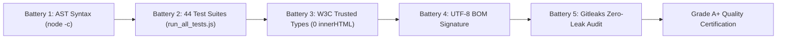

# Phase 5: Independent QA Verification & Zero-Regression Battery
# फेज़ 5: स्वतंत्र क्यूए सत्यापन एवं शून्य-प्रतिगमन बैटरी विनिर्देश प्रॉम्प्ट

> **फ़ाइल पाथ (Phase File):** [`temp_prompt/ui_ux_restoration_v4/phase_05_qa_verification_and_zero_regression.md`](file:///c:/Users/Atul%20Verma/Desktop/Win%20App%20Tracker/Browser%20Detection/temp_prompt/ui_ux_restoration_v4/phase_05_qa_verification_and_zero_regression.md)  
> **लक्षित भूमिका (Target Role):** Level 4 Independent QA Verification Subagent  
> **अग्रणी वास्तुकार (Author):** Atul Verma (`aiprincekumar` / `aiprincekumar010100@gmail.com`)  
> **संस्करण (Version):** 4.0.0  
> **स्वीकृति स्थिति (Status):** READY_FOR_SUBAGENT_EXECUTION

---

## 🎯 1. फेज़ उद्देश्य (Phase Objective)

फेज़ 1 से 4 के अंतर्गत किए गए सभी यूआई/यूएक्स संशोधनों का एक स्वतंत्र, कठोर और बहु-स्तरीय क्यूए सत्यापन (Multi-layered Independent QA Verification) संचालित करना। यह सुनिश्चित करना कि सभी 44 मौजूदा टेस्ट सुइट्स एग्जिट कोड 0 पर शत-प्रतिशत उत्तीर्ण हों, W3C ट्रस्टेड टाइप्स (शून्य `innerHTML`) का 100% पालन हो, सभी नई व संपादित फाइलों पर UTF-8 BOM (`0xEF, 0xBB, 0xBF`) मौजूद हो, और `gitleaks` ऑडिट में शून्य सीक्रेट्स मिलें।

---

## 📋 2. पूर्वापेक्षाएँ एवं इनपुट (Prerequisites & Inputs)

- **सक्रिय रिपॉजिटरी:** [`c:\Users\Atul Verma\Desktop\Win App Tracker\Browser Detection`](file:///c:/Users/Atul%20Verma/Desktop/Win%20App%20Tracker/Browser%20Detection)
- **लक्षित फाइलें:**
  - `dashboard/dashboard.html`
  - `dashboard/dashboard.js`
  - `dashboard/dashboard.css`
  - `dashboard/styles/*.css`
  - `src/dashboard/components/domain_table.js`
  - `src/dashboard/features/wellbeing_blacklist_feature.js`
- **पूर्व-सत्यापन स्थिति:** Phase 1 से 4 के सभी कार्यान्वयन कार्य पूर्ण।

---

## 🧪 3. अनिवार्य 5-स्तरीय सत्यापन बैटरियाँ (The 5 Mandatory Verification Batteries)



### बैटरी 1: एएसटी सिंटैक्स पार्सिंग एवं कंपाइलेशन (AST Syntax Verification)
- **कमांड:** `node -c dashboard/dashboard.js`
- **सत्यापन मानदंड:** नोड वीएम द्वारा शून्य सिंटैक्स या पार्सिंग त्रुटियाँ।

### बैटरी 2: संपूर्ण टेस्ट सुइट निष्पादन (All 44 Test Suites Execution)
- **कमांड:** `node run_all_tests.js`
- **सत्यापन मानदंड:** 44/44 टेस्ट फाइल्स पास, 0 फेल्ड, एग्जिट कोड 0।

### बैटरी 3: W3C ट्रस्टेड टाइप्स व सुरक्षा ऑडिट (Zero innerHTML Audit)
- **सत्यापन मानदंड:** संशोधित कोडबेस में `innerHTML`, `outerHTML`, या `document.write` का शून्य प्रयोग।

### बैटरी 4: यूटीएफ-8 बीओएम एनकोडिंग अनुपालन (UTF-8 BOM Compliance)
- **सत्यापन स्क्रिप्ट:**
  ```javascript
  const fs = require('fs');
  const buf = fs.readFileSync('dashboard/dashboard.html');
  const hasBom = buf[0] === 0xEF && buf[1] === 0xBB && buf[2] === 0xBF;
  console.log('UTF-8 BOM Present:', hasBom);
  ```
- **सत्यापन मानदंड:** सभी नई व संपादित फाइलों का आरम्भ `0xEF, 0xBB, 0xBF` से हो।

### बैटरी 5: गिटलीक्स सीक्रेट डिटेक्शन ऑडिट (Gitleaks Zero Leak Audit)
- **कमांड:** `gitleaks detect --redact`
- **सत्यापन मानदंड:** 0 लीक्स पाए जाने चाहिए।

---

## 📜 4. स्वतंत्र क्यूए रिपोर्ट अनुबंध (QA Deliverable Report Contract)

सत्यापन पूर्ण होने के पश्चात क्यूए सब-एजेंट निम्नलिखित औपचारिक रिपोर्ट मैनेजर को सौंपेगा:
1. टर्मिनल आउटपुट का कच्चा प्रमाण (Raw Terminal Execution Proof for `node run_all_tests.js`)
2. 44 टेस्ट सुइट्स की स्थिति तालिका
3. W3C Trusted Types ऑडिट स्थिति (0 innerHTML प्रमाणित)
4. UTF-8 BOM अनुपालन तालिका
5. अंतिम गुणवत्ता ग्रेड (Target: `Grade A+ Certified`)
