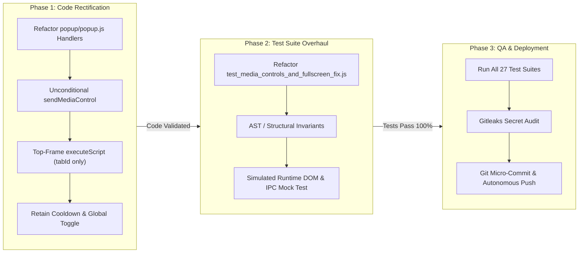

# Executive Architecture Summary
## Unconditional IPC Media Control Dispatch & Real Functional Verification

> **Initiative:** Chrome Extension MV3 Media Control & Verification Overhaul  
> **Target Path:** [`c:\Users\Atul Verma\Desktop\Win App Tracker\Browser Detection`](file:///c:/Users/Atul%20Verma/Desktop/Win%20App%20Tracker/Browser%20Detection)  
> **Author:** Level 3C Phase-wise Prompt Generation Specialist  
> **Date:** 2026-11-16  

---

## 🎯 1. Architectural Mission & Scope

The purpose of this initiative is to resolve a critical architectural anti-pattern in the Web Activity & Media Sentinel Chrome extension popup and test suite.

Previously, `popup/popup.js` implemented a "single-dispatch" pattern where `sendMediaControl(...)` was only called inside `.catch()` or `else` fallback branches of `browserAPI.scripting.executeScript`. This caused the background service worker and `content_media.js` to be starved of media control IPC packets whenever `executeScript` succeeded. Furthermore, `executeScript` targeted `allFrames: true`, causing unnecessary and potentially conflicting script execution across subframes.

This initiative delivers a robust 3-phase architectural rectification:
1. **Unconditional IPC Dispatch:** Re-aligns `popup/popup.js` so that `sendMediaControl` is dispatched unconditionally on every media control action, while keeping top-frame `executeScript` as immediate low-latency assistance.
2. **Top-Frame Direct Targeting:** Omits `allFrames: true` so scripts execute cleanly in top frame `{ tabId: targetTabId }`.
3. **On-Video Overlay & Fullscreen Linkage:** Preserves direct triggering of `#__sentinel_fs_floating_btn__` and `window.__SentinelFullscreenController.toggle(null, { forceWeb: true })` alongside background IPC.
4. **Optimistic Cooldown & Global Button Freeze:** Retains cooldown timestamps (`lastPlayToggleTime`, `lastMuteToggleTime`, `lastSpeedChangeTime`) and keeps `#btnGlobalMediaToggle` (`TOGGLE_GLOBAL_MEDIA`) 100% frozen and untouched.
5. **Dual-Tier Test Suite Overhaul:** Overhauls `tests/test_media_controls_and_fullscreen_fix.js` to replace string matching and obsolete fallback-only assertions with real AST/code structure checks and an end-to-end simulated runtime mock execution harness.

---

## 🗺️ 2. Milestone Roadmap & Dependencies

---

## ⚖️ 3. Architectural Invariants & Tradeoff Analysis

1. **Unconditional IPC vs. Direct Scripting:**
   - *Design Choice:* In an MV3 Chrome Extension, the background service worker is the authoritative coordinator of state, analytics, native HUD integration, and tab synchronizations. Bypassing the background worker on successful DOM injection breaks state consistency.
   - *Resolution:* Dispatch `sendMediaControl` unconditionally. If `executeScript` is supported and tabId is present, execute top-frame script immediately for instant feedback, while the background worker processes the authoritative command envelope.
2. **Top Frame vs. All Frames:**
   - *Design Choice:* Media elements and floating overlays operate in the primary document. Running in `allFrames: true` is hazardous for iframe security, performance, and ad frames.
   - *Resolution:* Target `{ tabId: targetTabId }` without `allFrames: true`.
3. **Global Toggle vs. In-Card Play/Pause:**
   - *Design Choice:* `#btnGlobalMediaToggle` pauses/resumes all media across all browser windows. In-card `#btnCtrlTogglePlay` / `#dynamicStatusBtn` controls only the targeted active media tab.
   - *Resolution:* Strictly isolate `#btnGlobalMediaToggle` (`TOGGLE_GLOBAL_MEDIA`); never merge or alter its binding.
