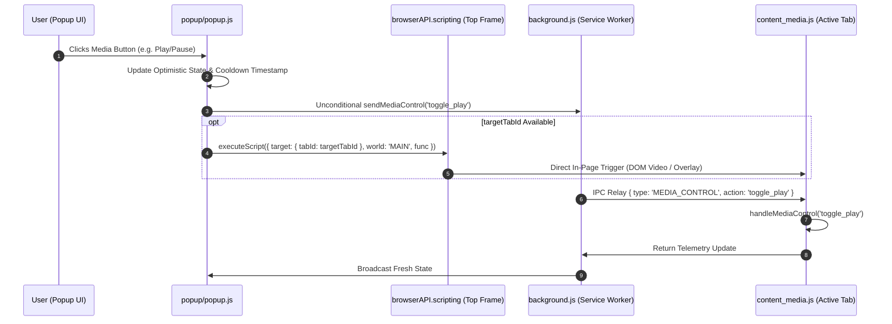

# Technical Requirements Document (TRD)
## Architectural Specification for Unconditional IPC & Top-Frame Media Dispatch

> **System Component:** `popup/popup.js` & `tests/test_media_controls_and_fullscreen_fix.js`  
> **Target Framework:** Chrome Extension MV3, Vanilla JavaScript (ES2022+), Node.js Verification  
> **Author:** Level 3C Phase-wise Prompt Generation Specialist  
> **Date:** 2026-11-16  

---

## 🏛️ 1. Technical Architecture & Data Flow



---

## 🔧 2. Code Rectification Specification (`popup/popup.js`)

### 2.1 Refactoring Handler Blueprint
For each media control button:
1. Set cooldown timestamp / optimistic UI update synchronously.
2. Unconditionally invoke `sendMediaControl(action, payload, targetTabId)`.
3. If `browserAPI.scripting && browserAPI.scripting.executeScript && targetTabId`:
   - Call `browserAPI.scripting.executeScript`:
     ```javascript
     browserAPI.scripting.executeScript({
       target: { tabId: targetTabId }, // MUST OMIT allFrames: true
       world: 'MAIN',
       func: () => { ... }
     }).catch(() => {});
     ```
   - Notice: the `.catch(() => {})` does NOT need to call `sendMediaControl` because `sendMediaControl` is already dispatched unconditionally!

### 2.2 Concrete Handler Transformations

#### A. Play/Pause (`handleTogglePlay`)
```javascript
const handleTogglePlay = () => {
  lastPlayToggleTime = Date.now();
  if (activeMediaCached && typeof activeMediaCached.isPlaying === 'boolean') {
    activeMediaCached.isPlaying = !activeMediaCached.isPlaying;
    renderMediaCard({ primaryMedia: activeMediaCached });
  }
  const targetTabId = (activeMediaCached && activeMediaCached.tabId) ||
    (dashboardData && dashboardData.globalMediaState && dashboardData.globalMediaState.primaryMedia && dashboardData.globalMediaState.primaryMedia.tabId);

  // Unconditional IPC Dispatch
  sendMediaControl('toggle_play', {}, targetTabId);

  // Assistive top-frame in-page execution
  if (browserAPI.scripting && typeof browserAPI.scripting.executeScript === 'function' && targetTabId) {
    browserAPI.scripting.executeScript({
      target: { tabId: targetTabId },
      world: 'MAIN',
      func: () => {
        const moviePlayer = document.getElementById('movie_player') || window.movie_player;
        if (moviePlayer && typeof moviePlayer.getPlayerState === 'function') {
          try {
            if (moviePlayer.getPlayerState() === 1) {
              moviePlayer.pauseVideo();
            } else {
              moviePlayer.playVideo();
            }
            return;
          } catch (_) {}
        }
        const video = Array.from(document.querySelectorAll('video')).find(v => !v.paused) || document.querySelector('video');
        if (video) {
          if (video.paused) {
            const p = video.play();
            if (p && typeof p.catch === 'function') p.catch(() => {});
          } else {
            video.pause();
          }
        }
      }
    }).catch(() => {});
  }
};
```

#### B. Rewind 10s (`#btnCtrlRewind`)
```javascript
btnRewind.addEventListener('click', () => {
  lastProgressDragTime = Date.now();
  if (activeMediaCached && typeof activeMediaCached.currentTime === 'number') {
    activeMediaCached.currentTime = Math.max(0, activeMediaCached.currentTime - 10);
    renderMediaCard({ primaryMedia: activeMediaCached });
  }
  const targetTabId = (activeMediaCached && activeMediaCached.tabId) ||
    (dashboardData && dashboardData.globalMediaState && dashboardData.globalMediaState.primaryMedia && dashboardData.globalMediaState.primaryMedia.tabId);

  // Unconditional IPC Dispatch
  sendMediaControl('seek_relative', { offsetSeconds: -10 }, targetTabId);

  // Assistive top-frame in-page execution
  if (browserAPI.scripting && typeof browserAPI.scripting.executeScript === 'function' && targetTabId) {
    browserAPI.scripting.executeScript({
      target: { tabId: targetTabId },
      world: 'MAIN',
      func: () => {
        const moviePlayer = document.getElementById('movie_player') || window.movie_player;
        const video = Array.from(document.querySelectorAll('video')).find(v => !v.paused) || document.querySelector('video');
        let cur = 0;
        let dur = 999999;
        if (moviePlayer && typeof moviePlayer.getCurrentTime === 'function') {
          try { cur = moviePlayer.getCurrentTime() || 0; } catch (_) {}
        } else if (video && Number.isFinite(video.currentTime)) {
          cur = video.currentTime;
        }
        if (moviePlayer && typeof moviePlayer.getDuration === 'function') {
          try { dur = moviePlayer.getDuration() || 999999; } catch (_) {}
        } else if (video && Number.isFinite(video.duration) && video.duration > 0) {
          dur = video.duration;
        }
        const clampedTarget = Math.max(0, Math.min(dur, cur - 10));
        if (moviePlayer && typeof moviePlayer.seekTo === 'function') {
          try { moviePlayer.seekTo(clampedTarget, true); } catch (_) {}
        }
        if (video) {
          try { video.currentTime = clampedTarget; } catch (_) {}
        }
      }
    }).catch(() => {});
  }
});
```

#### C. Forward 10s (`#btnCtrlForward`)
```javascript
btnForward.addEventListener('click', () => {
  lastProgressDragTime = Date.now();
  if (activeMediaCached && typeof activeMediaCached.currentTime === 'number') {
    activeMediaCached.currentTime = activeMediaCached.currentTime + 10;
    renderMediaCard({ primaryMedia: activeMediaCached });
  }
  const targetTabId = (activeMediaCached && activeMediaCached.tabId) ||
    (dashboardData && dashboardData.globalMediaState && dashboardData.globalMediaState.primaryMedia && dashboardData.globalMediaState.primaryMedia.tabId);

  // Unconditional IPC Dispatch
  sendMediaControl('seek_relative', { offsetSeconds: 10 }, targetTabId);

  // Assistive top-frame in-page execution
  if (browserAPI.scripting && typeof browserAPI.scripting.executeScript === 'function' && targetTabId) {
    browserAPI.scripting.executeScript({
      target: { tabId: targetTabId },
      world: 'MAIN',
      func: () => {
        const moviePlayer = document.getElementById('movie_player') || window.movie_player;
        const video = Array.from(document.querySelectorAll('video')).find(v => !v.paused) || document.querySelector('video');
        let cur = 0;
        let dur = 999999;
        if (moviePlayer && typeof moviePlayer.getCurrentTime === 'function') {
          try { cur = moviePlayer.getCurrentTime() || 0; } catch (_) {}
        } else if (video && Number.isFinite(video.currentTime)) {
          cur = video.currentTime;
        }
        if (moviePlayer && typeof moviePlayer.getDuration === 'function') {
          try { dur = moviePlayer.getDuration() || 999999; } catch (_) {}
        } else if (video && Number.isFinite(video.duration) && video.duration > 0) {
          dur = video.duration;
        }
        const clampedTarget = Math.max(0, Math.min(dur, cur + 10));
        if (moviePlayer && typeof moviePlayer.seekTo === 'function') {
          try { moviePlayer.seekTo(clampedTarget, true); } catch (_) {}
        }
        if (video) {
          try { video.currentTime = clampedTarget; } catch (_) {}
        }
      }
    }).catch(() => {});
  }
});
```

#### D. Mute Toggle (`handleToggleMute`)
```javascript
const handleToggleMute = () => {
  lastMuteToggleTime = Date.now();
  if (activeMediaCached && typeof activeMediaCached.isMuted === 'boolean') {
    activeMediaCached.isMuted = !activeMediaCached.isMuted;
    renderMediaCard({ primaryMedia: activeMediaCached });
  }
  const targetTabId = (activeMediaCached && activeMediaCached.tabId) ||
    (dashboardData && dashboardData.globalMediaState && dashboardData.globalMediaState.primaryMedia && dashboardData.globalMediaState.primaryMedia.tabId);

  // Unconditional IPC Dispatch
  sendMediaControl('toggle_mute', {}, targetTabId);

  // Assistive top-frame in-page execution
  if (browserAPI.scripting && typeof browserAPI.scripting.executeScript === 'function' && targetTabId) {
    browserAPI.scripting.executeScript({
      target: { tabId: targetTabId },
      world: 'MAIN',
      func: () => {
        const moviePlayer = document.getElementById('movie_player') || window.movie_player;
        if (moviePlayer && typeof moviePlayer.isMuted === 'function') {
          try {
            if (moviePlayer.isMuted()) {
              if (typeof moviePlayer.unMute === 'function') moviePlayer.unMute();
            } else {
              if (typeof moviePlayer.mute === 'function') moviePlayer.mute();
            }
            return;
          } catch (_) {}
        }
        const video = Array.from(document.querySelectorAll('video')).find(v => !v.paused) || document.querySelector('video');
        if (video) {
          video.muted = !video.muted;
        }
      }
    }).catch(() => {});
  }
};
```

#### E. Speed Steppers (`#btnCtrlSpeedDown` & `#btnCtrlSpeedUp`)
```javascript
// btnCtrlSpeedDown
sendMediaControl('step_speed', { direction: 'down', targetSpeed, step: -0.25 }, targetTabId);
if (browserAPI.scripting && typeof browserAPI.scripting.executeScript === 'function' && targetTabId) {
  browserAPI.scripting.executeScript({
    target: { tabId: targetTabId },
    world: 'MAIN',
    func: (sp) => {
      const moviePlayer = document.getElementById('movie_player') || window.movie_player;
      if (moviePlayer && typeof moviePlayer.setPlaybackRate === 'function') {
        try { moviePlayer.setPlaybackRate(sp); } catch (_) {}
      }
      document.querySelectorAll('video, audio').forEach(el => {
        try { el.playbackRate = sp; } catch (_) {}
      });
    },
    args: [targetSpeed]
  }).catch(() => {});
}

// btnCtrlSpeedUp
sendMediaControl('step_speed', { direction: 'up', targetSpeed, step: 0.25 }, targetTabId);
if (browserAPI.scripting && typeof browserAPI.scripting.executeScript === 'function' && targetTabId) {
  browserAPI.scripting.executeScript({
    target: { tabId: targetTabId },
    world: 'MAIN',
    func: (sp) => {
      const moviePlayer = document.getElementById('movie_player') || window.movie_player;
      if (moviePlayer && typeof moviePlayer.setPlaybackRate === 'function') {
        try { moviePlayer.setPlaybackRate(sp); } catch (_) {}
      }
      document.querySelectorAll('video, audio').forEach(el => {
        try { el.playbackRate = sp; } catch (_) {}
      });
    },
    args: [targetSpeed]
  }).catch(() => {});
}
```

#### F. Fullscreen Toggle (`#btnCtrlFullscreen`)
```javascript
btnFullscreen.addEventListener('click', () => {
  const now = Date.now();
  if (now - lastFullscreenClick < 350) return;
  lastFullscreenClick = now;

  const targetTabId = (activeMediaCached && activeMediaCached.tabId) ||
    (dashboardData && dashboardData.globalMediaState && dashboardData.globalMediaState.primaryMedia && dashboardData.globalMediaState.primaryMedia.tabId);

  // Unconditional IPC Dispatch
  sendMediaControl('toggle_fullscreen', {}, targetTabId);

  // Direct top-frame execution with Priority 1 floating button click & Priority 2 controller fallback
  if (browserAPI.scripting && typeof browserAPI.scripting.executeScript === 'function' && targetTabId) {
    browserAPI.scripting.executeScript({
      target: { tabId: targetTabId },
      world: 'MAIN',
      func: () => {
        const floatingBtn = document.getElementById('__sentinel_fs_floating_btn__');
        if (floatingBtn && typeof floatingBtn.click === 'function') {
          floatingBtn.click();
          return;
        }
        if (window.__SentinelFullscreenController && typeof window.__SentinelFullscreenController.toggle === 'function') {
          window.__SentinelFullscreenController.toggle(null, { forceWeb: true });
          return;
        }
        const moviePlayer = document.getElementById('movie_player') || window.movie_player;
        const nativeFsBtn = document.querySelector('.ytp-fullscreen-button') ||
          document.querySelector('button[data-title*="Fullscreen"]') ||
          document.querySelector('button[aria-label*="Fullscreen"]') ||
          document.querySelector('.vjs-fullscreen-control');
        if (nativeFsBtn && typeof nativeFsBtn.click === 'function') {
          nativeFsBtn.click();
          return;
        }
        const keyTarget = moviePlayer || document.querySelector('video') || document.body;
        if (keyTarget) {
          keyTarget.dispatchEvent(new KeyboardEvent('keydown', { key: 'f', code: 'KeyF', keyCode: 70, bubbles: true }));
        }
      }
    }).catch(() => {});
  }
});
```

---

## 🧪 3. Test Suite Overhaul Blueprint (`tests/test_media_controls_and_fullscreen_fix.js`)

1. **AST & Structural Integrity Tests:**
   - Verify every handler calls `sendMediaControl(...)` unconditionally.
   - Verify all `executeScript` configurations omit `allFrames: true`.
   - Verify `btnCtrlFullscreen` links with `__sentinel_fs_floating_btn__` and `window.__SentinelFullscreenController.toggle`.
   - Verify `#btnGlobalMediaToggle` is bound strictly to `TOGGLE_GLOBAL_MEDIA`.
   - Verify absence of old 124-line manual DOM class bloat.
2. **Runtime Simulated Mock Test:**
   - Execute a VM sandbox loading the relevant popup button wiring.
   - Simulate button clicks for:
     - `dynamicStatusBtn` / `btnCtrlTogglePlay`
     - `btnCtrlRewind`
     - `btnCtrlForward`
     - `btnCtrlToggleMute`
     - `btnCtrlSpeedDown`
     - `btnCtrlSpeedUp`
     - `btnCtrlFullscreen`
   - Intercept calls to `sendMediaControl` and `browserAPI.scripting.executeScript`.
   - Confirm with `assert.strictEqual` that each click dispatches both `sendMediaControl` and top-frame `executeScript`.
