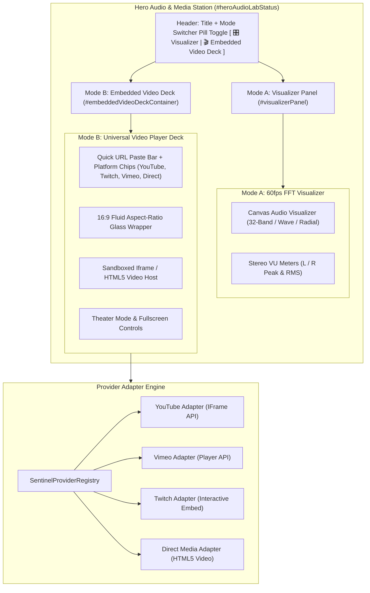
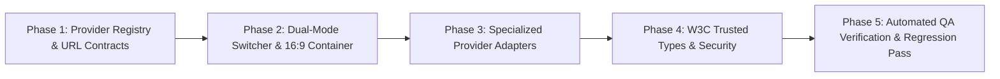

# Executive Architecture Summary: Universal Embedded Video Player Deck

> **Document Type:** Executive Scope & Architectural Roadmap  
> **Initiative:** Universal Embedded Video Player Deck for Web Activity & Media Sentinel  
> **Target Path:** `temp_prompt/universal_video_embed_deck/SUMMARY.md`  
> **Governance:** [`PHASE_WISE_PROMPT_GENERATION_ARCHITECTURE.md`](file:///C:/Users/Atul%20Verma/.gemini/config/rules/PHASE_WISE_PROMPT_GENERATION_ARCHITECTURE.md)  
> **Lead Architect:** Atul Verma (`aiprincekumar` / `aiprincekumar010100@gmail.com`)  

---

## 🎯 1. Executive Vision & Scope

The **Web Activity & Media Sentinel** dashboard currently provides robust multi-tab media monitoring, remote playback control, and real-time 60fps audio frequency spectrum visualization. However, users tracking media sessions in other browser tabs (or wishing to preview video content directly) face friction when they must constantly switch browser windows to see the actual video stream.

The **Universal Embedded Video Player Deck** transforms the hero visualizer bento card ([`dashboard/dashboard.html#L725-L776`](file:///c:/Users/Atul%20Verma/Desktop/Win%20App%20Tracker/Browser%20Detection/dashboard/dashboard.html#L725-L776)) into a **Dual-Mode Media Station**:
1. **Mode A (Audio Visualizer Canvas):** The existing 60fps FFT spectrum, oscilloscope waveform, radial frequency burst, and analog VU meters.
2. **Mode B (Embedded Video Player Deck):** A high-performance, responsive 16:9 embedded player station supporting YouTube, Vimeo, Twitch, and direct HTML5 video streams with bi-directional remote playback controls, theater mode expansion, and W3C Trusted Types sandboxing.

---

## 🏛️ 2. Architectural Paradigm: Switchable Deck vs Destructive Replacement

Rather than destructively deleting or permanently replacing the existing audio visualizer canvas, this architecture enforces a **Non-Destructive Dual-Mode Switchable Deck Paradigm**:

| Architectural Dimension | Destructive Replacement (Rejected) | Switchable Dual-Mode Deck (Adopted) |
| :--- | :--- | :--- |
| **Canvas & FFT Parity** | Permanently removes canvas; breaks visualizer tests and audio monitoring. | 100% preserved; canvas loop sleeps when deck is active, wakes when toggled back. |
| **DOM Invariants** | Deletes canonical IDs (`#canvasAudioVisualizer`, `#selectVizEffect`). | All canonical IDs remain untouched; zero test breakage. |
| **User Flexibility** | Forces video embedding even for audio-only streams (Spotify, SoundCloud). | User selects Audio FFT mode for music and Video Deck mode for YouTube/Twitch. |
| **System Resource Impact** | Unpredictable CPU usage. | Pauses 60fps canvas `requestAnimationFrame` when video is playing, preventing CPU waste. |
| **Trusted Types Security** | Ad-hoc iframe injection prone to XSS. | Formal `sentinel-embed-policy` with sandboxing and strict origin whitelisting. |

---

## 🗺️ 3. Cross-Phase Milestone Roadmap & Topology

- **Phase 1 (Provider Registry & URL Contracts):** Establishes the core plugin architecture and regex normalization engines for 30+ URL variants.
- **Phase 2 (Dual-Mode Switcher & 16:9 Container):** Implements the UI container, mode switching toggle, liquid glass responsive styling, and empty state paste bar.
- **Phase 3 (Specialized Provider Adapters):** Authors the bi-directional postMessage communication bridges for YouTube, Vimeo, Twitch, and direct HTML5 video.
- **Phase 4 (W3C Trusted Types & Security):** Registers the Trusted Types security policy, enforces iframe sandboxing attributes, and implements origin validation.
- **Phase 5 (QA Verification & Regression Pass):** Delivers a 6-battery test suite (`tests/test_universal_video_embed_deck.js`), verifies all 54 existing suites pass with exit code 0, checks BOM headers, and runs clean gitleaks scan.

---

## ⚖️ 4. Architectural Trade-off Analysis & Risk Mitigation Matrix

| Risk Factor | Severity | Probability | Architectural Mitigation |
| :--- | :--- | :--- | :--- |
| **Iframe XSS / Clickjacking** | High | Low | Rigid iframe sandboxing without `allow-top-navigation`; origin whitelisting; Trusted Types policy enforcement. |
| **Dual Audio Playback (Dashboard + Source Tab)** | Medium | High | By default, embeds launch in muted state or offer an explicit "Mute Remote Tab" button via background IPC. |
| **Twitch Parent Domain Restriction** | Medium | Medium | Twitch embed API strictly requires `parent=<hostname>`. Adapter dynamically injects `window.location.hostname` or defaults to `localhost`. |
| **Visualizer 60fps Loop Battery Drain** | Low | High | `MediaDeckVisualizerFeature.stopVisualizerLoop()` automatically pauses the `requestAnimationFrame` loop when Deck mode is active. |
| **Third-Party Rate Limits / Adblockers** | Low | Medium | Standard official embed endpoints (`youtube-nocookie.com`, `player.vimeo.com`) are used with clear error fallbacks. |

---

## 🔒 5. Strict Backward-Compatibility & Non-Interference Invariants

1. **Zero InnerHTML Mutation:** At no point may raw string concatenation be passed to `innerHTML`. All iframe and DOM elements must be instantiated via `document.createElement()` and configured via explicit property assignments.
2. **Canonical DOM Invariance:** Elements `#canvasAudioVisualizer`, `#selectVizEffect`, `#heroAudioLabStatus`, `#vuBarLeft`, `#vuBarRight` must retain their exact attributes, styles, and event capabilities.
3. **Existing Test Suite Zero Regression:** The workspace contains 54 comprehensive test suites. All 54 suites must continue to pass with 0 failures before and after this feature is landed.
4. **Encoding & Standards:** All new and modified files must be strictly encoded as UTF-8 with BOM (`0xEF, 0xBB, 0xBF`).
