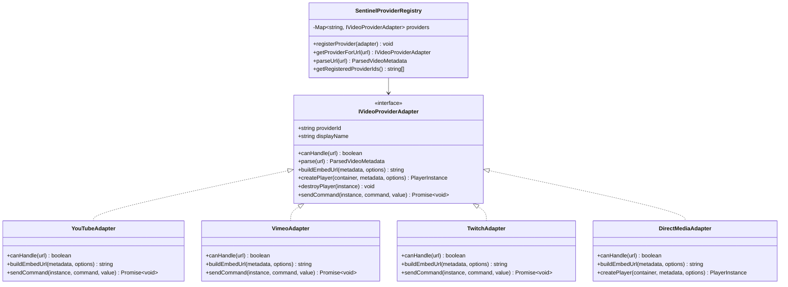
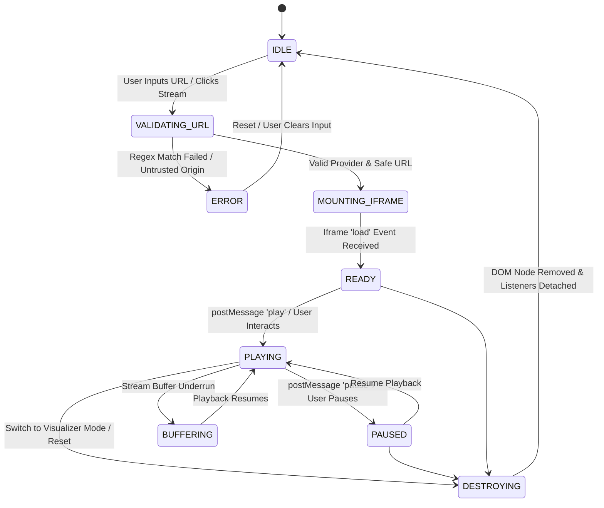

# Technical Requirements Document (TRD): Universal Embedded Video Player Deck

> **Document Type:** Low-Level & High-Level Architectural Specification (LLD / HLD)  
> **Module Path:** `temp_prompt/universal_video_embed_deck/TRD.md`  
> **Target Subsystem:** `src/dashboard/features/embed_player_deck/`  
> **Lead Department:** Dept 02 Solution Architecture, Dept 05 Frontend, Dept 10 AppSec  
> **Security Standard:** W3C Trusted Types Level 2, Strict Iframe Sandboxing  

---

## 🏛️ 1. High-Level Architecture (HLD)

The Universal Embedded Video Player Deck is structured into four decoupled layers:
1. **Presentation & Layout Layer:** Dual-mode switcher, 16:9 fluid aspect container, theater expansion mechanism in `dashboard/dashboard.html` & `dashboard.css`.
2. **Provider Registry & Parser Layer:** `SentinelProviderRegistry` providing abstract provider registration and normalized URL parsing.
3. **Adapter & PostMessage Bridge Layer:** Platform-specific adapters (`YouTubeAdapter`, `VimeoAdapter`, `TwitchAdapter`, `DirectMediaAdapter`) managing iframe lifecycle and bi-directional RPC commands.
4. **Security & Sandboxing Layer:** `TrustedTypesPolicy` ensuring zero raw innerHTML, sandbox permission enforcement, and origin whitelist verification.



---

## 🔧 2. Low-Level Design (LLD) & Data Contracts

### 2.1 Parsed Video Metadata Contract
```typescript
interface ParsedVideoMetadata {
  providerId: 'youtube' | 'vimeo' | 'twitch' | 'direct' | 'unknown';
  videoId: string;             // e.g. "dQw4w9WgXcQ", "76979871", "shroud"
  mediaType: 'video' | 'stream' | 'clip' | 'playlist' | 'direct_file';
  canonicalUrl: string;        // Normalized clean URL
  embedUrl: string;            // Validated embed URL ready for iframe
  title?: string;              // Optional inferred title
  startTime?: number;          // Start timestamp in seconds
  autoplay?: boolean;          // Autoplay preference (muted by default)
}
```

### 2.2 Provider URL Detection Regex Manifest
| Provider | Regex Matching Engine | Normalized Extracted ID | Embed URL Pattern |
| :--- | :--- | :--- | :--- |
| **YouTube** | `/(?:youtube\.com\/(?:watch\?v=|embed\/|v\/|shorts\/)|youtu\.be\/)([a-zA-Z0-9_-]{11})/` | 11-char alphanumeric ID | `https://www.youtube-nocookie.com/embed/{id}?enablejsapi=1&origin={origin}&rel=0` |
| **Vimeo** | `/(?:vimeo\.com\/(?:video\/)?)([0-9]{6,12})/` | 6 to 12 digit numeric ID | `https://player.vimeo.com/video/{id}?api=1` |
| **Twitch Channel** | `/(?:twitch\.tv\/)([a-zA-Z0-9_]{3,25})(?!\/clip)/` | Channel username | `https://player.twitch.tv/?channel={id}&parent={parent}&autoplay=true` |
| **Twitch Clip** | `/(?:clips\.twitch\.tv\/([a-zA-Z0-9_-]+)|twitch\.tv\/[^/]+\/clip\/([a-zA-Z0-9_-]+))/` | Clip slug ID | `https://clips.twitch.tv/embed?clip={id}&parent={parent}` |
| **Direct Media**| `/\.(mp4|webm|ogg|m4v|m3u8)(\?.*)?$/i` | Direct file path | Native HTML5 `<video controls playsinline>` |

---

## 📡 3. Bi-Directional PostMessage RPC Protocol

To provide unified playback control across third-party iframe providers without requiring external monolithic SDK bundles, the player deck uses native `postMessage` RPC wrappers:

### 3.1 YouTube IFrame API PostMessage Format
```javascript
// Outbound command dispatch
function sendYouTubeCommand(iframeWindow, funcName, args = []) {
  if (!iframeWindow) return;
  const message = JSON.stringify({
    event: 'command',
    func: funcName,
    args: args
  });
  iframeWindow.postMessage(message, 'https://www.youtube-nocookie.com');
}

// Command mappings:
// Play:   sendYouTubeCommand(win, 'playVideo')
// Pause:  sendYouTubeCommand(win, 'pauseVideo')
// Mute:   sendYouTubeCommand(win, 'mute')
// Unmute: sendYouTubeCommand(win, 'unMute')
// Seek:   sendYouTubeCommand(win, 'seekTo', [seconds, true])
// Volume: sendYouTubeCommand(win, 'setVolume', [volumePercent])
```

### 3.2 Vimeo Player API PostMessage Format
```javascript
// Outbound command dispatch
function sendVimeoCommand(iframeWindow, method, value) {
  if (!iframeWindow) return;
  const message = JSON.stringify({
    method: method,
    value: value
  });
  iframeWindow.postMessage(message, 'https://player.vimeo.com');
}

// Command mappings:
// Play:  sendVimeoCommand(win, 'play')
// Pause: sendVimeoCommand(win, 'pause')
// Mute:  sendVimeoCommand(win, 'setVolume', 0)
// Seek:  sendVimeoCommand(win, 'setCurrentTime', seconds)
```

---

## 🔄 4. Finite State Machine (FSM)



### State Matrix
| State | Active UI Elements | Visualizer Loop | Audio Output | Allowed Transitions |
| :--- | :--- | :--- | :--- | :--- |
| **IDLE** | URL Input bar, Platform Chips, Empty Placeholder | PAUSED | None | `VALIDATING_URL` |
| **VALIDATING_URL** | Loading Spinner, Disabled Input | PAUSED | None | `MOUNTING_IFRAME`, `ERROR` |
| **MOUNTING_IFRAME** | Loading Spinner, Glass Frame | PAUSED | None | `READY`, `ERROR` |
| **READY** | Iframe Visible, Control Overlay, Theater Button | PAUSED | Muted/Ready | `PLAYING`, `DESTROYING` |
| **PLAYING** | Iframe Active, Live Status Badge ("LIVE STREAM") | PAUSED | Active | `PAUSED`, `BUFFERING`, `DESTROYING` |
| **PAUSED** | Iframe Active, Paused Badge | PAUSED | Silent | `PLAYING`, `DESTROYING` |
| **ERROR** | Inline Alert, Retry Button, Clear Button | PAUSED | None | `IDLE`, `VALIDATING_URL` |
| **DESTROYING** | Transient Cleanup Routine | RESUMING | Cleaned | `IDLE` |

---

## 🛡️ 5. W3C Trusted Types & Iframe Sandboxing Architecture

### 5.1 Trusted Types Policy Registration
```javascript
let embedPolicy = null;
if (typeof window !== 'undefined' && window.trustedTypes && typeof window.trustedTypes.createPolicy === 'function') {
  try {
    embedPolicy = window.trustedTypes.createPolicy('sentinel-embed-policy', {
      createScriptURL: (url) => {
        // Enforce strict HTTPS and whitelisted domains
        const parsed = new URL(url, window.location.href);
        if (isAllowedEmbedOrigin(parsed.origin)) {
          return url;
        }
        throw new TypeError('[SecurityPolicyViolation] Disallowed embed script URL: ' + url);
      },
      createHTML: (html) => {
        throw new TypeError('[SecurityPolicyViolation] Direct HTML injection prohibited. Use DOM createElement.');
      }
    });
  } catch (err) {
    console.warn('[EmbedPolicy] Policy already registered or restricted:', err);
  }
}
```

### 5.2 Mandatory Iframe Construction Protocol
All iframe elements MUST be created strictly via programmatic DOM creation:
```javascript
function createSafeEmbedIframe(embedUrl, providerId) {
  const iframe = document.createElement('iframe');
  
  // Mandatory sandbox flags: explicitly omit 'allow-top-navigation'
  iframe.setAttribute('sandbox', 'allow-scripts allow-same-origin allow-presentation allow-forms');
  iframe.setAttribute('allow', 'accelerometer; autoplay; clipboard-write; encrypted-media; gyroscope; picture-in-picture; web-share');
  iframe.setAttribute('referrerpolicy', 'strict-origin-when-cross-origin');
  iframe.setAttribute('loading', 'lazy');
  iframe.setAttribute('frameBorder', '0');
  iframe.className = 'embedded-deck-iframe';
  iframe.id = 'embeddedPlayerIframe';
  
  // Validate URL origin before setting src
  const parsed = new URL(embedUrl);
  if (!isAllowedEmbedOrigin(parsed.origin)) {
    throw new Error('Disallowed origin: ' + parsed.origin);
  }
  
  iframe.src = embedUrl;
  return iframe;
}
```

### 5.3 Allowed Origin Whitelist
```javascript
const ALLOWED_EMBED_ORIGINS = new Set([
  'https://www.youtube-nocookie.com',
  'https://www.youtube.com',
  'https://player.vimeo.com',
  'https://player.twitch.tv',
  'https://clips.twitch.tv',
  'https://www.dailymotion.com'
]);

function isAllowedEmbedOrigin(origin) {
  if (ALLOWED_EMBED_ORIGINS.has(origin)) return true;
  // Allow localhost for local development / tests
  if (origin === 'http://localhost' || origin.startsWith('http://localhost:')) return true;
  return false;
}
```
