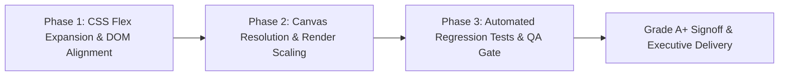

# Executive Architecture Summary
# Initiative: Visualizer Inner UI Content Expansion
# Task ID: TASK-VIZ-INNER-EXPAND-001

> **Governance & Specification Reference:**
> - **Lead Specialist:** Level 3C Phase-wise Prompt Generation Specialist (`prompt_generation_specialist`)
> - **Architecture Recommendation:** [`architecture_recommendation.md`](file:///C:/Users/Atul%20Verma/.gemini/config/rules/architecture_recommendation.md)
> - **Prompt Architecture:** [`PHASE_WISE_PROMPT_GENERATION_ARCHITECTURE.md`](file:///C:/Users/Atul%20Verma/.gemini/config/rules/PHASE_WISE_PROMPT_GENERATION_ARCHITECTURE.md)
> - **Active Working Memory:** [`memory.md`](file:///C:/Users/Atul%20Verma/.gemini/memory.md)

---

## 🏛️ 1. High-Level Initiative Scope & Technical Objectives

The objective of this initiative is to expand the inner UI content of the **Real-Time Spectrum Visualizer** (`#heroAudioLabStatus`) within the Sentinel Web Activity & Media Tracker dashboard so that it fills the outer container organically, eliminating awkward dead space and maximizing visual telemetry impact while **strictly preserving outer container bounds and height**.

### Key Technical Objectives:
1. **Internal Content Expansion:** Maximize the vertical footprint of the frequency canvas and visualizer components from ~130px to ~200px-240px (a >53% visual expansion).
2. **Strict Outer Invariance:** The outer card bounds (`bento-span-4 bento-row-span-2`, `min-height: 380px`, padding, outer borders, margin) MUST NOT be modified or increased. Bento grid harmony is preserved 100%.
3. **Elastic Flexbox Architecture:** Implement an unbroken CSS flexbox pipeline (`flex: 1 1 auto; height: 100%; min-height: 0;`) across `.visualizer-card-body`, `.visualizer-panel`, and `.visualizer-canvas-container`.
4. **Dynamic Canvas Resolution & Scale:** Upgrade canvas resolution management and the 60 FPS rendering pipeline in `dashboard.js` and `media_deck_visualizer_feature.js` to dynamically calculate aspect ratio and vertical amplitudes.
5. **Zero-Regression Assurance:** Guarantee 100% test pass rate across all existing visualizer, fullscreen, layout, and regression test batteries.

---

## 🗺️ 2. Cross-Phase Milestone Roadmap & Dependency Topology

### Dependency Breakdown:
- **Phase 1 (Frontend):** Resolves the styling blockage by removing hardcoded `height: 130px` and establishing elastic flex rules. Unlocks Phase 2.
- **Phase 2 (Fullstack):** Leverages the expanded container geometry from Phase 1 to calibrate dynamic canvas sizing and rendering loops. Unlocks Phase 3.
- **Phase 3 (QA):** Validates both structural CSS, canvas rendering math, and end-to-end dashboard integrity, certifying Exit Code 0.

---

## ⚖️ 3. Risk Mitigation & Architectural Tradeoff Analysis

| Decision / Tradeoff | Selected Approach | Alternative Rejected | Architectural Rationale |
| :--- | :--- | :--- | :--- |
| **Container Sizing Model** | Elastic Flexbox Growth (`flex: 1 1 auto; height: 100%`) | Increasing card `min-height` to 480px | Increasing outer height would break bento grid row alignment with sibling cards and violates strict user constraint. Elastic flex growth fills whatever container height is available. |
| **Canvas Dimensionality** | Dynamic native pixel scaling (`canvas.width`, `canvas.height`) | CSS bitmap stretching (`width: 100%; height: 100%`) | Pure CSS bitmap scaling causes severe pixelation, blurry text, and jagged spectrum bars. Updating internal canvas resolution preserves razor-sharp 60 FPS rendering. |
| **VU Meter Placement** | Pinned to card bottom via `margin-top: auto; flex-shrink: 0;` | Overlaid on top of canvas | Overlaying VU meters obscures lower spectrum frequencies; bottom docking gives clean, professional audiophile studio deck aesthetics. |

---

## 🛡️ 4. Execution Strategy Recommendation

- **Recommended Strategy:** **Strategy A: Fully Autonomous Phase-wise Execution**
- **Autonomy Score:** **1.0** (Deterministic scope, zero ambiguity, clear acceptance gates).
- **Execution Workflow:** Level 2 Manager issues `AUTH-MGR-*` tokens and dispatches Phases 1 through 3 sequentially to dedicated Level 4 Sub Agents.
