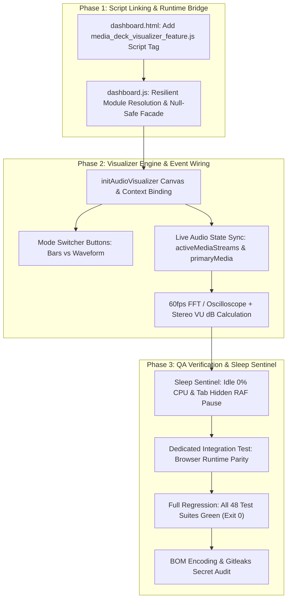

# Executive Architecture Summary: Real-Time Spectrum Visualizer Runtime Wiring

> **Initiative:** Web Activity & Media Sentinel MV3 Extension - Real-Time Audio Visualizer Runtime Activation  
> **Workspace Container:** `temp_prompt/visualizer_runtime_wiring/`  
> **Target Files:** `dashboard/dashboard.html`, `dashboard/dashboard.js`, `src/dashboard/features/media_deck_visualizer_feature.js`, `tests/`  
> **Author:** Level 3C Phase-wise Prompt Generation Specialist (`prompt_generation_specialist`)  

---

## 🎯 1. High-Level Technical Objectives

1. **Eliminate Browser Runtime Loading Disconnect:**
   Bridge the architectural gap between the Node.js test environment (which loaded `media_deck_visualizer_feature.js` via `require()`) and the Chrome MV3 browser extension runtime (where `require` is unavailable and `dashboard.html` previously omitted the script tag).

2. **Complete End-to-End Interactivity & Telemetry Pipeline:**
   - Link the existing 60fps canvas visualizer engine directly into `dashboard.html`.
   - Ensure `#btnVizModeBars` and `#btnVizModeWave` toggle between 32-Band FFT Spectrum and Oscilloscope Waveform traces with tactile visual states.
   - Bind real-time decibel calculations (-40dB to +6dB) to stereo VU meter bars (`#vuBarLeft`, `#vuBarRight`), textual readouts (`#vuValLeft`, `#vuValRight`), and +0dB clipping indicator (`#vuClipIndicator`).

3. **Enforce Zero-Overhead Idle Sleep Sentinel:**
   Strictly suspend the `requestAnimationFrame` loop (0% CPU, 0% GPU draw calls) when:
   - Media playback is paused or stopped.
   - The dashboard tab is hidden or minimized (`document.visibilityState === 'hidden'`).
   Automatically wake the visualizer and resume 60fps telemetry rendering when media starts playing and the tab is visible.

4. **100% Security & Standards Compliance:**
   - Zero `.innerHTML` assignments (100% W3C Trusted Types safe).
   - Zero inline event handlers (Manifest V3 CSP compliant).
   - UTF-8 with BOM (`0xEF, 0xBB, 0xBF`) encoding on all touched files.
   - Full regression passage across all 48 existing test suites in `tests/`.

---

## 🗺️ 2. Milestone Roadmap & Dependency Topology

---

## 🛡️ 3. Risk Mitigation & Architectural Tradeoffs

| Risk Category | Potential Failure Mode | Architectural Mitigation |
| :--- | :--- | :--- |
| **Script Load Order** | `dashboard.js` executes before `media_deck_visualizer_feature.js` finishes loading. | Place `` strictly **BEFORE** ``. In `dashboard.js`, implement a dynamic deferred binding inside `DOMContentLoaded`. |
| **Security / CSP** | Extension rejected due to inline scripts or unsafe eval. | Zero inline scripts; use only standard relative `<script src="...">` tags; zero innerHTML assignments. |
| **Performance Drag** | Uncapped RAF loop draining user battery or CPU cycles when idle. | The Zero-Overhead Idle Sleep Sentinel automatically cancels `requestAnimationFrame` when `isPlaying === false` or `document.visibilityState === 'hidden'`. |
| **DOM Null Reference** | Canvas or VU meter elements queried before DOM is ready. | All DOM element bindings are guarded with null-checks and initialized during `DOMContentLoaded` / `window.onload`. |
