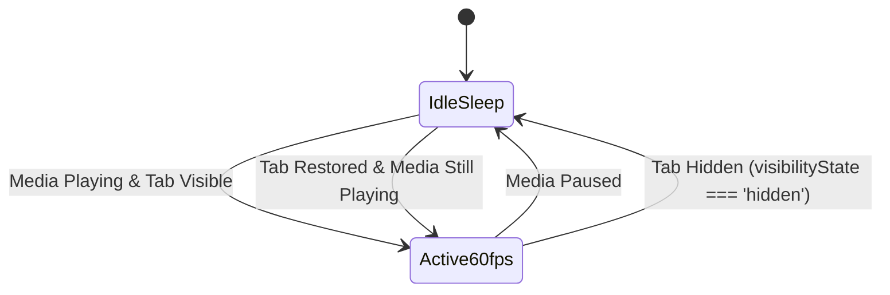

# Technical Requirements Document (TRD): Real-Time Spectrum Visualizer

> **Document Type:** Technical Requirements Document  
> **Target Container:** `temp_prompt/visualizer_runtime_wiring/`  
> **Status:** APPROVED FOR IMPLEMENTATION  

---

## 🏗️ 1. Low-Level Architecture & Script Loading Pipeline

### 1.1 Script Inclusion in `dashboard/dashboard.html`
In `dashboard/dashboard.html`, modify script loading at the bottom of the `<body>`:

```html
  <!-- Feature Modules (Browser-accessible relative imports) -->
  <script src="../src/dashboard/features/media_deck_visualizer_feature.js"></script>
  <!-- Core Dashboard Controller -->
  <script src="dashboard.js"></script>
</body>
</html>
```

### 1.2 Module Resolution Contract in `dashboard/dashboard.js`
Update the module resolution for `_MediaDeckVisualizer`:

```javascript
const _MediaDeckVisualizer = (function() {
  if (typeof globalThis !== 'undefined' && globalThis.MediaDeckVisualizerFeature) {
    return globalThis.MediaDeckVisualizerFeature;
  }
  if (typeof window !== 'undefined' && window.MediaDeckVisualizerFeature) {
    return window.MediaDeckVisualizerFeature;
  }
  return _safeRequire('./src/dashboard/features/media_deck_visualizer_feature.js', '../src/dashboard/features/media_deck_visualizer_feature.js');
})();
```

Add dynamic binding inside `DOMContentLoaded` / initialization to re-check `window.MediaDeckVisualizerFeature` if script loading finishes asynchronously:

```javascript
function getResolvedVisualizer() {
  if (_MediaDeckVisualizer) return _MediaDeckVisualizer;
  if (typeof window !== 'undefined' && window.MediaDeckVisualizerFeature) {
    return window.MediaDeckVisualizerFeature;
  }
  return null;
}
```

---

## 🎛️ 2. Event Binding & Interactivity Specifications

### 2.1 Mode Switcher Event Handlers
Ensure both buttons have robust event listeners attached:
- `#btnVizModeBars`:
  ```javascript
  btnVizModeBars.addEventListener('click', (e) => {
    e.preventDefault();
    setVisualizerMode('bars');
  });
  ```
- `#btnVizModeWave`:
  ```javascript
  btnVizModeWave.addEventListener('click', (e) => {
    e.preventDefault();
    setVisualizerMode('wave');
  });
  ```

### 2.2 Decibel & VU Meter Scaling Formulas
- **Amplitude to dB Conversion:**
  $$\text{dB} = 20 \cdot \log_{10}(\text{amplitude})$$
  Clamped between $-40\text{ dB}$ (silence) and $+6\text{ dB}$ (max boost).
- **dB to Percentage Conversion:**
  $$\text{Percent} = \frac{\text{dB} - (-40)}{6 - (-40)} \times 100\% = \frac{\text{dB} + 40}{46} \times 100\%$$
- **Clipping Logic:**
  $$\text{isClipping} = (\text{leftDb} \ge 0) \lor (\text{rightDb} \ge 0)$$

---

## 💤 3. Zero-Overhead Idle Sleep Sentinel



1. **Visibility Listener:**
   `document.addEventListener('visibilitychange', () => { ... })` cancels RAF immediately on `'hidden'` and triggers clean redraw baseline.
2. **Audio State Hook:**
   `setAudioPlayingState(isPlaying)` starts or stops loop conditionally.

---

## 🔒 4. Security & Standards Governance
- Strict W3C Trusted Types: No DOM element creation or updating may use `.innerHTML` or `.outerHTML`.
- Standard DOM properties (`.textContent`, `.style.width`, `.classList.add/remove`) must be used exclusively.
- All files must be saved with UTF-8 BOM (`0xEF, 0xBB, 0xBF`).
