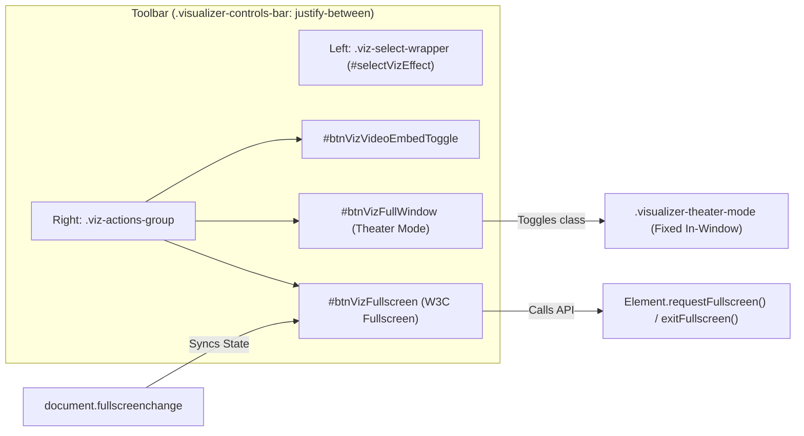

<!-- 0xEF, 0xBB, 0xBF UTF-8 BOM Encoded -->
# Technical Requirements Document (TRD)
# Task: Visualizer Toolbar Flex Alignment & Dual-Mode Full Window / Full Screen Controls
# Task ID: TASK-VIZ-TOOLBAR-ALIGN-FULLSCREEN-001

> **Lead Department:** Dept 04 System Architecture & Dept 05 Frontend Engineering
> **Status:** APPROVED FOR IMPLEMENTATION

---

## 🏛️ 1. Architecture & Component Interaction



---

## 🔧 2. Low-Level Design & File Modifications

### 2.1 DOM Structure (`dashboard/dashboard.html`)
Inside `#visualizerPanel`:
```html
<div class="visualizer-controls visualizer-controls-bar">
  <label for="selectVizEffect" id="lblVizEffect" class="viz-dropdown-label visually-hidden" data-i18n="visualizer_effect_label">Effect:</label>
  <div class="viz-select-wrapper">
    <select id="selectVizEffect" class="form-select visualizer-mode-select select-viz-effect glass-select" aria-label="Audio Visualizer Effect">
      <!-- Options unchanged -->
    </select>
  </div>
  <div class="viz-actions-group">
    <!-- Button 1: Video Embed Toggle -->
    <button type="button" id="btnVizVideoEmbedToggle" class="btn-viz-action-icon" title="Switch to Video Player (Embed Mode)" aria-label="Switch to Video Player (Embed Mode)" aria-pressed="false" tabindex="0">
      <!-- Video SVG -->
    </button>
    <!-- Button 2: Full Window (Theater Viewport Maximize) -->
    <button type="button" id="btnVizFullWindow" class="btn-viz-action-icon" title="Toggle Visualizer Full Window (Theater)" aria-label="Toggle Visualizer Full Window (Theater)" aria-expanded="false" tabindex="0">
      <svg class="viz-action-svg viz-icon-window-expand" viewBox="0 0 24 24" width="14" height="14" fill="none" stroke="currentColor" stroke-width="2" stroke-linecap="round" stroke-linejoin="round" aria-hidden="true">
        <rect x="3" y="3" width="18" height="18" rx="2" ry="2"></rect>
        <line x1="9" y1="3" x2="9" y2="21"></line>
      </svg>
    </button>
    <!-- Button 3: True Fullscreen (W3C requestFullscreen) -->
    <button type="button" id="btnVizFullscreen" class="btn-viz-action-icon" title="Toggle Visualizer Fullscreen" aria-label="Toggle Visualizer Fullscreen" aria-expanded="false" tabindex="0">
      <svg class="viz-action-svg viz-icon-expand" viewBox="0 0 24 24" width="14" height="14" fill="none" stroke="currentColor" stroke-width="2" stroke-linecap="round" stroke-linejoin="round" aria-hidden="true">
        <polyline points="15 3 21 3 21 9"></polyline>
        <polyline points="9 21 3 21 3 15"></polyline>
        <line x1="21" y1="3" x2="14" y2="10"></line>
        <line x1="3" y1="21" x2="10" y2="14"></line>
      </svg>
      <svg class="viz-action-svg viz-icon-compress visually-hidden" viewBox="0 0 24 24" width="14" height="14" fill="none" stroke="currentColor" stroke-width="2" stroke-linecap="round" stroke-linejoin="round" aria-hidden="true">
        <polyline points="4 14 10 14 10 20"></polyline>
        <polyline points="20 10 14 10 14 4"></polyline>
        <line x1="14" y1="10" x2="21" y2="3"></line>
        <line x1="3" y1="21" x2="10" y2="14"></line>
      </svg>
    </button>
  </div>
</div>
```

### 2.2 CSS Specifications (`dashboard/styles/media.css` & `dashboard/dashboard.css`)
```css
.visualizer-controls-bar {
  display: flex !important;
  justify-content: space-between !important;
  align-items: center !important;
  width: 100% !important;
  box-sizing: border-box !important;
  background: rgba(15, 23, 42, 0.65);
  padding: 4px 8px;
  border-radius: 9999px;
  border: 1px solid rgba(255, 255, 255, 0.1);
  backdrop-filter: blur(12px) saturate(160%);
  -webkit-backdrop-filter: blur(12px) saturate(160%);
  box-shadow: 0 2px 8px rgba(0, 0, 0, 0.25), inset 0 1px 0 rgba(255, 255, 255, 0.08);
}

.viz-actions-group {
  display: inline-flex;
  align-items: center;
  gap: 6px;
  margin-left: auto;
}
```

### 2.3 JavaScript Specifications (`src/dashboard/features/media_deck_visualizer_feature.js`)
1. **Full Window / Theater State:**
   - `isFullWindowActive` boolean.
   - `toggleVisualizerFullWindow(options)` toggles `.visualizer-theater-mode` on `#heroAudioLabStatus`.
2. **True Fullscreen State:**
   - `isNativeFullscreenActive` boolean.
   - `toggleVisualizerFullscreen(options)`:
     - If `document.fullscreenElement`, calls `document.exitFullscreen()`.
     - Else, calls `targetElement.requestFullscreen().catch(err => toggleVisualizerFullWindow(options))`.
3. **Event Listener:**
   - Listen to `document.addEventListener('fullscreenchange', ...)` to synchronize `#btnVizFullscreen` icon and ARIA states when exiting via Esc key.
