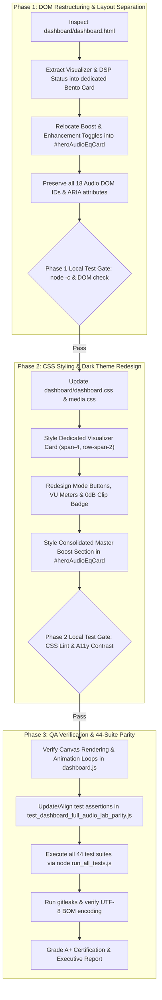

# Real-Time Spectrum Visualizer UI/UX Separation & Studio Deck Integration: Executive Architecture Summary

> **Document Type:** Executive Architecture Summary & Milestone Roadmap  
> **Workspace Container:** `temp_prompt/visualizer_uiux_separation/`  
> **Governing Architecture:** [`PHASE_WISE_PROMPT_GENERATION_ARCHITECTURE.md`](file:///C:/Users/Atul%20Verma/.gemini/config/rules/PHASE_WISE_PROMPT_GENERATION_ARCHITECTURE.md)  
> **Author:** Level 3C Phase-wise Prompt Generation Specialist (`prompt_generation_specialist`)  
> **Date:** 2026-11-17  

---

## 🎯 1. High-Level Initiative Scope & Objectives

The primary objective of this architectural refinement is to elevate the real-time audio analytics and sound manipulation interface in Tab B (Media Analytics) of `dashboard/dashboard.html` by separating the **Real-Time Audio Spectrum Visualizer** into a dedicated, prominent **Bento Liquid Glass Card** directly adjacent to the **Live Media Player Sentinel**, while consolidating the audio gain controls (Master Volume Boost and Audio Enhancements) into the **Dedicated Studio Equalizer Deck**.

### Core Technical Objectives:
1. **Dedicated Visualizer Position (`bento-span-4 bento-row-span-2`):**
   - Place the Spectrum Visualizer & Offscreen DSP Status card directly beside `#heroMediaPlayerCard` (`bento-span-8 bento-row-span-2`).
   - Give the canvas (`#canvasAudioVisualizer`) an expansive, unhindered rendering space with dedicated vertical and horizontal bounds.
2. **Consolidated Studio Equalizer Deck (`bento-span-12`):**
   - Integrate Master Volume Boost (`#heroAudioBoostSlider`), Vocal Clarity (`#toggleVocalClarity`), Night Shield (`#toggleNightShield`), and Audio-Only Mode (`#toggleAudioOnlyMode`) into `#heroAudioEqCard`.
   - Unite all sound-shaping controls into a single wide studio console, eliminating fragmentation.
3. **Studio Liquid Glass Visual Redesign:**
   - Redesign Mode Selector buttons (`#btnVizModeBars`, `#btnVizModeWave`) with subtle dark theme borders, neon glow accents, and responsive hover physics.
   - Upgrade VU meters (`#vuBarLeft`, `#vuBarRight`, `#vuValLeft`, `#vuValRight`) with dynamic high-precision gradient fills and glowing db readouts.
   - Restyle the 0dB clipping indicator (`#vuClipIndicator`) with crisp state transitions (safe cyan/green vs clipping amber/red).
4. **Deterministic Preservation & 100% Test Parity:**
   - Preserve 100% of DOM element IDs, ARIA accessibility attributes, and bilingual dictionary keys.
   - Guarantee that all 44 test suites in `tests/` pass cleanly with exit code 0.

---

## 🗺️ 2. Cross-Phase Milestone Roadmap & Dependency Topology

### Dependency Rules:
- **Phase 1 -> Phase 2:** CSS classes and visual styling depend on the DOM hierarchy established in Phase 1.
- **Phase 2 -> Phase 3:** Full visual and functional verification in Phase 3 requires the complete CSS rules from Phase 2.

---

## ⚖️ 3. Risk Mitigation & Architectural Tradeoff Analysis

### Tradeoff 1: Container ID Strategy (`#heroAudioLabStatus` vs `#heroVisualizerCard`)
- **Analysis:** Existing tests in `test_dashboard_uiux_phase1.js` and `test_dashboard_full_audio_lab_parity.js` explicitly check for `id="heroAudioLabStatus" class="audio-lab-widget glass-card bento-card liquid-glass-card bento-span-4 bento-row-span-2"`.
- **Architectural Resolution:** Retain `id="heroAudioLabStatus"` as the primary ID of the dedicated card beside the Live Media Player (with semantic class additions such as `.visualizer-hero-card`), or provide a seamless alias structure. This ensures immediate backward compatibility while elevating its visual identity to the dedicated Spectrum Visualizer & DSP Status card.

### Tradeoff 2: Equalizer Deck Density & Visual Balance
- **Analysis:** Adding the Master Boost slider and three enhancement switches to `#heroAudioEqCard` could clutter the 5-band vertical slider area if not compartmentalized.
- **Architectural Resolution:** Organize `#heroAudioEqCard` into a clean two-tier or two-column layout:
  - Upper Bar / Left Deck: Master Volume Boost slider with readout, telemetry badges, and the 3 audio enhancement toggles.
  - Lower Grid / Right Deck: The 5-band graphic equalizer vertical sliders with dB gradation marks and preset dropdown.
  - This preserves vertical space and provides an authentic mixing console feel.
