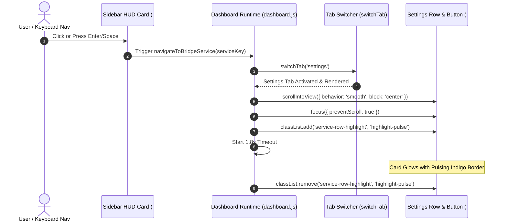

# Executive Architecture Summary: WebSocket Status Interactivity & Navigation

> **Task Workspace:** `temp_prompt/websocket_status_interactivity/`  
> **Target System:** Web Activity & Media Sentinel (Chrome Extension MV3)  
> **Lead Architect:** Atul Verma (`aiprincekumar` / `aiprincekumar010100@gmail.com`)  
> **Operating Protocol:** 4-Level Command Hierarchy & Mandatory Decision Gate  

---

## 🎯 Executive Initiative Overview

The **Web Activity & Media Sentinel** dashboard sidebar contains a compact telemetry HUD cluster displaying the status of three critical subsystems:
1. `🧘 Focus Sentinel` (Pomodoro wellbeing timer micro-widget)
2. `SQLite Data Hub` (Standalone local database daemon on `ws://127.0.0.1:65433`)
3. `Video Detector HUD` (Windows native desktop overlay bridge on `ws://127.0.0.1:65432`)

While `#wellbeingLiveMicroWidget` already features interactive click navigation to `#tabContentWellbeing`, the SQLite Data Hub and Video Detector HUD status widgets currently serve as passive visual indicators.

This initiative upgrades both WebSocket status widgets into accessible, interactive triggers that provide a seamless transition from **observing a connection issue** in the sidebar to **reconnecting or configuring the service** in the Settings tab.

---

## 📐 Architecture & Interaction Design

---

## 🔑 Key Engineering Deliverables

1. **Semantic DOM & Accessibility (Phase 1):**
   - Canonical IDs `#sidebarDataHubCard` and `#sidebarHudCard`.
   - WAI-ARIA role `role="button"` and keyboard focusability `tabindex="0"`.
   - Contextual `aria-label` and `title` attributes indicating interactive navigation.
   - 100% preservation of inner telemetry elements (`#dataHubSidebarDot`, `#dataHubSidebarLabel`, `#hudStatusDot`, `#hudStatusLabel`).

2. **Liquid Glass & Glow Animations (Phase 2):**
   - Interactive hover elevation and active button press transform.
   - Focus ring (`:focus-visible`) styled with `--accent-primary` for WCAG 2.1 AA compliance.
   - `@keyframes serviceRowHighlightGlow` and `@keyframes reconnectBtnPulse` for transient visual beaconing upon navigation.

3. **Runtime Event Handling & Telemetry Invariance (Phase 3):**
   - Modular navigation dispatch function `navigateToBridgeService(serviceKey)`.
   - Event listeners for `click` and `keydown` (`Enter`, `' '`).
   - Tactile haptic feedback integration with `SentinelHapticAudioEngine.playClick()`.
   - Strict zero-regression guarantee for `updateHUDStatus()` and `updateDataHubStatus()`.

4. **Automated Verification & Zero-Leak Security (Phase 4):**
   - New dedicated verification suite: `tests/test_sidebar_websocket_interactivity.js`.
   - 55/55 clean test pass via `node run_all_tests.js`.
   - UTF-8 with BOM (`0xEF, 0xBB, 0xBF`) enforcement.
   - W3C Trusted Types compliance (0 innerHTML mutations).
   - Secret audit via `gitleaks detect --redact` (0 leaks).
