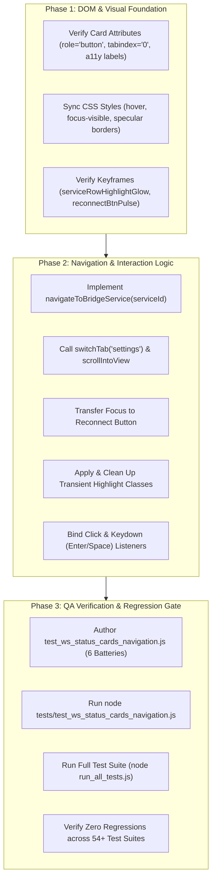

# Executive Architecture Summary — Interactive WebSocket Connection Status Cards

> **Initiative:** Interactive WebSocket Status Cards & Deep-Link Navigation to Settings  
> **Target Module:** Web Activity & Media Sentinel (MV3 Extension Dashboard)  
> **Governance:** [`PHASE_WISE_PROMPT_GENERATION_ARCHITECTURE.md`](file:///C:/Users/Atul%20Verma/.gemini/config/rules/PHASE_WISE_PROMPT_GENERATION_ARCHITECTURE.md)  
> **Status:** Architecture Certified (Level 3C Specialist)  

---

## 🏛️ 1. High-Level Initiative Scope

The Web Activity & Media Sentinel extension features real-time WebSocket communication bridges connecting to local desktop daemons:
- **SQLite Data Hub Daemon (`ws://127.0.0.1:65433` - WAL mode):** Provides persistent high-concurrency event telemetry and SQLite database storage.
- **Video Detector HUD Bridge (`ws://127.0.0.1:65432`):** Provides real-time desktop overlay synchronization for Windows video detection and media sentinels.

The extension dashboard sidebar displays compact status widgets for both services. When these daemons are offline or disconnected, users need a seamless, single-action pathway from the sidebar status indicator directly into the specific service's configuration and reconnection controls within the Settings view.

This initiative makes both WebSocket status indicator cards interactive, accessible, and linked directly to their corresponding service rows and reconnect buttons in the Settings pane, providing:
1. **Direct Affordance:** Explicit hover states, pointer cursors, and accessible button semantics.
2. **Deep-Link Navigation:** Instant transition to the Settings tab (`switchTab('settings')`).
3. **Targeted Viewport Alignment:** Smooth scrolling directly to the specific service row.
4. **Immediate Second-Action Focus:** Automatic transfer of keyboard focus to the corresponding Reconnect button (`#btnSidebarReconnectHub` or `#btnSidebarReconnect`), enabling immediate reconnection on second click or keypress.
5. **Transient Visual Feedback:** Specular glow and pulse animations indicating the target service.

---

## 🗺️ 2. Milestone Roadmap & Dependency Topology

---

## 🛡️ 3. Risk Mitigation & Architectural Guardrails

| Risk Area | Potential Failure Mode | Architectural Mitigation Strategy |
| :--- | :--- | :--- |
| **Tab Transition Timing** | Scrolling before `#paneSettings` is rendered visible results in no-op or miscalculated scroll position. | Execute `scrollIntoView` inside `requestAnimationFrame` or `setTimeout(..., 60)` after `switchTab('settings')` has rendered the pane. |
| **Accessibility (WCAG 2.1 AA)** | Space keydown triggers browser window scrolling down instead of activating the card button. | Intercept `e.key === ' '` or `e.code === 'Space'` and explicitly call `e.preventDefault()`, matching standard WAI-ARIA button pattern. |
| **Animation Pollution** | Animation classes (`.service-row-highlight`, `.highlight-pulse`) persist indefinitely in DOM after repeated clicks. | Implement self-clearing timer (`setTimeout(..., 2000)`) with clear-on-retrigger to cleanly reset DOM class state. |
| **Motion Sensitivity** | High-intensity glowing animations cause distress for users with vestibular disorders. | Support `@media (prefers-reduced-motion: reduce)` with static border highlights and immediate jump scroll (`behavior: 'auto'`). |
| **W3C Trusted Types** | Introducing DOM injection or `innerHTML` violations breaks extension security policy. | Use strictly property manipulation (`classList.add`, `focus()`, `scrollIntoView()`) with zero `innerHTML` modifications. |
