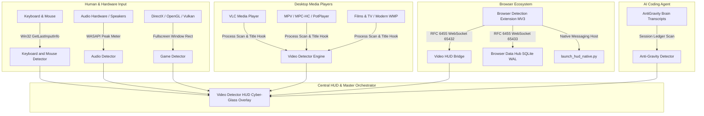
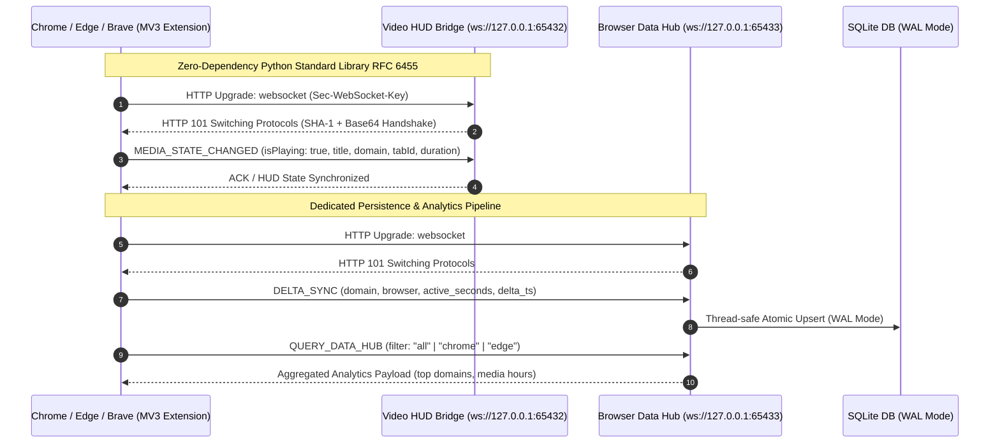

<div align="center">

# 🛡️ Win App Tracker

**Enterprise-Grade Windows Activity, Inactivity & Media Playback Sentinel Suite**  
*100% Dynamic • Offline-First • Zero Cloud Telemetry • Dual RFC 6455 WebSocket Bridges • Windows 10 & 11*

[](https://github.com/aiprincekumar/Win-App-Tracker/actions/workflows/ci.yml)
[](https://github.com/aiprincekumar/Win-App-Tracker/actions/workflows/gitleaks.yml)
[](LICENSE)
[-0078D6?logo=windows)](https://microsoft.com/windows)
[](https://python.org)
[](https://nodejs.org)
[](https://peps.python.org/pep-0008/)

</div>

---

## 📖 Table of Contents

- [🌟 Executive Overview](#-executive-overview)
- [🏛️ System Architecture](#️-system-architecture)
  - [Subsystem Topology](#subsystem-topology)
  - [Dual-WebSocket Real-Time Bridge Architecture](#dual-websocket-real-time-bridge-architecture)
- [🔍 Sentinel Detectors Deep-Dive](#-sentinel-detectors-deep-dive)
  - [1. 🎬 Video Detector HUD (Master Translucent Overlay)](#1--video-detector-hud-master-translucent-overlay)
  - [2. 🌐 Browser Telemetry Suite (Extension & Data Hub)](#2--browser-telemetry-suite-extension--data-hub)
  - [3. 🤖 Anti-Gravity Agent Sentinel](#3--anti-gravity-agent-sentinel)
  - [4. 🔊 Audio Playback & WASAPI Sentinel](#4--audio-playback--wasapi-sentinel)
  - [5. 🎮 Game Engine & DirectX/OpenGL Sentinel](#5--game-engine--directxopengl-sentinel)
  - [6. ⌨️ Keyboard & Mouse Physical Input Sentinel](#6-️-keyboard--mouse-physical-input-sentinel)
  - [7. 🎥 Standalone Video Playback Detector](#7--standalone-video-playback-detector)
- [⚡ 100% Dynamic & Portable Architecture](#-100-dynamic--portable-architecture)
- [🚀 Quick Start & Installation Guide](#-quick-start--installation-guide)
  - [1-Click Launchers](#1-click-launchers)
  - [Browser Extension Installation (Chrome, Edge, Brave)](#browser-extension-installation-chrome-edge-brave)
  - [Native Messaging & Custom URI Protocol Registration](#native-messaging--custom-uri-protocol-registration)
- [⚙️ Command-Line Interface (CLI) Reference](#️-command-line-interface-cli-reference)
- [🔌 WebSocket & IPC API Specification](#-websocket--ipc-api-specification)
- [📂 Repository Directory Structure](#-repository-directory-structure)
- [🧪 Automated Testing & Continuous Integration](#-automated-testing--continuous-integration)
- [🔒 Security & Offline Privacy Policy](#-security--offline-privacy-policy)
- [👤 Author & Maintainer](#-author--maintainer)
- [📄 License](#-license)

---

## 🌟 Executive Overview

**Win App Tracker** is a modular, high-precision telemetry and inactivity monitoring framework engineered specifically for Microsoft Windows 10 and 11. Built from the ground up for zero cognitive bloat and strict local-first execution, it solves the complex challenge of distinguishing between **true human inactivity** and **passive system engagement** (e.g. watching long videos, listening to music, rendering 3D games, or monitoring autonomous AI agent operations).

### Key Architectural Strengths:
- **Zero Cloud Leakage:** 100% offline-first. Telemetry remains on `127.0.0.1` loopback and local SQLite databases.
- **Microsecond Precision:** Native Win32 API integration (`GetLastInputInfo`, WASAPI audio endpoints, `EnumWindows`, GDI+).
- **Dual RFC 6455 WebSocket Bridges:** Pure Python standard library implementation (zero pip requirements for WebSocket servers).
- **Multi-Player Video Fleet:** Out-of-the-box title extraction and playback state detection for 12+ desktop media players and UWP applications.
- **Cross-Browser Manifest V3 Suite:** Real-time DOM media hook, per-domain active time tracker, bilingual UI (English/Hindi), and sub-millisecond tab switching.
- **AI Agent Session Tracking:** Live inspection of Google AntiGravity AI coding agent sessions, tool execution in flight, and user interaction gates.

---

## 🏛️ System Architecture

### Subsystem Topology



### Dual-WebSocket Real-Time Bridge Architecture



---

## 🔍 Sentinel Detectors Deep-Dive

### 1. 🎬 Video Detector HUD (Master Translucent Overlay)
- **Directory:** [`Video Detector HUD/`](file:///Video%20Detector%20HUD/)
- **Core Technology:** Python Win32 GDI, Tkinter Cyber-Glass canvas, RFC 6455 WebSocket Server.
- **Features:**
  - **3 Operating Layouts:** Normal (460px multi-section view), Mini (90px card), and Collapse (28px edge-docked bar).
  - **Magnetic Docking:** 20px edge snapping to all 4 screen borders with persistent coordinate restoration.
  - **Universal Offline Player Fleet:** Native process, window handle, and playback state extraction for:
    - VLC Media Player (`vlc.exe`)
    - Media Player Classic - HC / BE (`mpc-hc.exe`, `mpc-hc64.exe`, `mpc-be.exe`)
    - PotPlayer (`potplayer.exe`, `potplayer64.exe`)
    - MPV (`mpv.exe`)
    - GOM Player (`gom.exe`, `gom64.exe`)
    - KMPlayer (`kmplayer.exe`, `kmplayer64.exe`)
    - 5KPlayer (`5kplayer.exe`)
    - BSPlayer (`bsplayer.exe`)
    - Kodi Home Theater (`kodi.exe`)
    - SMPlayer (`smplayer.exe`)
    - Windows Media Player Classic (`wmplayer.exe`)
    - Films & TV / Modern Media Player (`Microsoft.Media.Player`) via UWP SMTC integration.

### 2. 🌐 Browser Telemetry Suite (Extension & Data Hub)
- **Directories:** [`Browser Detection/`](file:///Browser%20Detection/) & [`Browser Data Hub/`](file:///Browser%20Data%20Hub/)
- **Core Technology:** Manifest V3 (Chrome, Microsoft Edge, Brave, Opera, Firefox) + Python SQLite Service.
- **Features:**
  - **Media State Sniffer:** Injected content script hooks into HTML5 `<video>` and `<audio>`, detecting YouTube, Netflix, Prime Video, Twitch, Coursera, Udemy, etc.
  - **Dynamic Browser Fingerprinting:** Auto-detects runtime browser (Google Chrome, Microsoft Edge, Brave, Opera).
  - **Multi-Browser Filter:** Filter analytics per-browser or across a unified master timeline.
  - **Sub-Millisecond Tab Focus:** `JUMP_TO_MEDIA_TAB` instantly focuses the exact browser window and tab playing media with a bottom fixed toast notification (CLS = 0).
  - **Bilingual Interface:** Pure English and Devanagari Hindi (100% lexical parity across 250+ dictionary keys).
  - **Thread-Safe SQLite Engine:** Dedicated service on port 65433 with Write-Ahead Logging (WAL) and offline buffering queue.

### 3. 🤖 Anti-Gravity Agent Sentinel
- **Directory:** [`Anti-Gravity Detector/`](file:///Anti-Gravity%20Detector/)
- **Core Technology:** JSONL trajectory parser, process tree inspection, Windows In-Place ANSI UI.
- **Features:**
  - Real-time ledger monitoring of `%USERPROFILE%\.gemini\antigravity\brain\`.
  - Four discrete state classifications:
    - `WORKING`: Agent executing tools, child subagents, or code synthesis.
    - `WAITING_USER`: Agent blocked at an interactive user confirmation gate (`ask_question`).
    - `SETTLING`: Post-execution cooldown hysteresis to prevent state flapping.
    - `COMPLETED`: Inactive / finished session with zero background tasks.
  - In-place ANSI terminal dashboard without scroll jitter.

### 4. 🔊 Audio Playback & WASAPI Sentinel
- **Directory:** [`Audio Detector/`](file:///Audio%20Detector/)
- **Core Technology:** Core Audio Windows APIs via `pycaw` and `comtypes`.
- **Features:**
  - Monitors default multimedia audio endpoints.
  - Reads hardware audio session states and real-time peak volume meters.
  - Filters out background system beeps vs. continuous media playback.
  - In-place terminal telemetry with English and Hindi status banners.

### 5. 🎮 Game Engine & DirectX/OpenGL Sentinel
- **Directory:** [`Game Detector/`](file:///Game%20Detector/)
- **Core Technology:** Win32 API (`GetForegroundWindow`, `GetWindowRect`, `GetWindowPlacement`), Process Token scan.
- **Features:**
  - Detects active 3D rendering engines (DirectX 9/11/12, Vulkan, OpenGL).
  - Evaluates window dimensions against native desktop display resolution to detect exclusive fullscreen and borderless windowed modes.
  - Distinguishes between paused game menus and active gameplay.

### 6. ⌨️ Keyboard & Mouse Physical Input Sentinel
- **Directory:** [`Keyboard and Mouse Detector/`](file:///Keyboard%20and%20Mouse%20Detector/)
- **Core Technology:** High-precision Win32 `GetLastInputInfo`.
- **Features:**
  - Ultra-fast 0.1s polling interval consuming 0.00% CPU.
  - Independent hardware event timestamps tracking user idle seconds.
  - Activity meter bar and 60-minute historical rolling trendline.

### 7. 🎥 Standalone Video Playback Detector
- **Directory:** [`Video Detector/`](file:///Video%20Detector/)
- **Core Technology:** Lightweight terminal-based video sentinel.
- **Features:**
  - Ideal for minimal headless server environments or headless scripts where a GUI overlay is not required.
  - Supports `--check-once` and `--json` for scripted shell pipelines and automated power management wrappers.

---

## ⚡ 100% Dynamic & Portable Architecture

Every launcher, script, and Python module is strictly portable:
- **Zero Absolute Machine Paths:** All file operations dynamically resolve via `%USERPROFILE%`, `%~dp0`, or `Path.home()`.
- **Drive-Agnostic:** Operates seamlessly whether mounted on `C:`, `D:`, `E:`, external SSDs, or networked UNC shares.
- **Auto-Discovery of Python Runtimes:** Launchers probe `.venv`, `%USERPROFILE%\.local\bin`, `uv`, and system PATH in sequential order.
- **UTF-8 with BOM Standard:** Batch runners and scripts utilize `chcp 65001` and UTF-8 encoding to eliminate Devanagari font corruption across Windows PowerShell 5.1, PowerShell 7+, and CMD.

---

## 🚀 Quick Start & Installation Guide

### Prerequisites
- **Operating System:** Microsoft Windows 10 or Windows 11 (64-bit)
- **Python:** 3.10, 3.11, or 3.12 (standard installation or virtualenv)
- **Node.js:** 18.x, 20.x, or 22.x (required for browser extension tests)

### 1-Click Launchers

Simply double-click the corresponding batch launcher from Windows File Explorer:

| Subsystem | 1-Click Launcher | Description |
| :--- | :--- | :--- |
| **Video Detector HUD** | [`Run_Video_Detector_HUD.bat`](file:///Video%20Detector%20HUD/Run_Video_Detector_HUD.bat) | Launches the Cyber-Glass desktop HUD overlay |
| **Browser Data Hub** | [`Run_Browser_Data_Hub.bat`](file:///Browser%20Data%20Hub/Run_Browser_Data_Hub.bat) | Starts the standalone SQLite WebSocket service (`:65433`) |
| **Anti-Gravity Sentinel** | [`Run_AntiGravity_Detector.bat`](file:///Anti-Gravity%20Detector/Run_AntiGravity_Detector.bat) | Starts live AI agent session monitor |
| **Audio Sentinel** | [`Run_Audio_Detector.bat`](file:///Audio%20Detector/Run_Audio_Detector.bat) | Starts WASAPI audio endpoint monitor |
| **Game Sentinel** | [`Run_Game_Detector.bat`](file:///Game%20Detector/Run_Game_Detector.bat) | Starts 3D fullscreen game activity monitor |
| **Keyboard & Mouse** | [`Run_Keyboard_Mouse_Detector.bat`](file:///Keyboard%20and%20Mouse%20Detector/Run_Keyboard_Mouse_Detector.bat) | Starts physical hardware input idle timer |
| **Standalone Video** | [`Run_Video_Detector.bat`](file:///Video%20Detector/Run_Video_Detector.bat) | Terminal-only video activity evaluator |

### Browser Extension Installation (Chrome, Edge, Brave)

1. Open your Chromium-based browser (Google Chrome, Microsoft Edge, Brave, Opera) and navigate to `chrome://extensions/` (or `edge://extensions/`).
2. Toggle on **Developer mode** in the top-right corner.
3. Click **Load unpacked** (लोड अनपैक्ड).
4. Select the folder:
   ```
   Win App Tracker\Browser Detection
   ```
5. Pin the extension to your toolbar. The extension will automatically connect to both the Video HUD (Port 65432) and Data Hub (Port 65433).

### Native Messaging & Custom URI Protocol Registration

For instant 1-click launcher integration from the browser extension popup, register the Windows protocol and Native Messaging Host:

```cmd
:: Run from an Administrator or Standard User Command Prompt
cd "Video Detector HUD\scripts"

:: Register custom videohud:// URI handler
call register_videohud_protocol.bat

:: Register com.antigravity.videohud Native Messaging Host in HKCU
call register_native_messaging_host.bat
```

---

## ⚙️ Command-Line Interface (CLI) Reference

All detectors support rich CLI flags for automation, scripting, and headless deployment:

```bash
# Anti-Gravity Detector: single check with structured JSON output
python "Anti-Gravity Detector/antigravity_detector.py" --once --json

# Video Detector HUD: custom refresh rate and idle buffer threshold
python "Video Detector HUD/src/video_detector_hud.py" --interval 0.5 --threshold 60.0

# Audio Detector: single check (Exit Code 0: Idle, 1: Audio Active)
python "Audio Detector/audio_detector.py" --once --json

# Keyboard and Mouse Detector: single hardware idle check
python "Keyboard and Mouse Detector/keyboard_mouse_detector.py" --once --json

# Video Detector Standalone: simulate 45s idle check
python "Video Detector/video_detector.py" --check-once --idle-sec 45.0 --json
```

### Common CLI Options:
| Flag | Description | Default |
| :--- | :--- | :--- |
| `--interval <sec>` | Polling loop refresh frequency | `0.1s` - `1.0s` |
| `--threshold <sec>` | Inactivity threshold before declaring system idle | `60.0s` |
| `--once` / `--check-once` | Execute a single evaluation and exit with status code | Disabled |
| `--json` | Format evaluation card as pure JSON (for pipeline integration) | Disabled |

---

## 🔌 WebSocket & IPC API Specification

### 1. Video HUD WebSocket Server (`ws://127.0.0.1:65432`)

#### Client Registration Frame:
```json
{
  "action": "REGISTER_CLIENT",
  "clientType": "BROWSER_EXTENSION",
  "browser": "Chrome",
  "version": "1.2.0"
}
```

#### Media State Changed Event:
```json
{
  "action": "MEDIA_STATE_CHANGED",
  "payload": {
    "isPlaying": true,
    "title": "Quantum Computing in 100 Seconds - YouTube",
    "domain": "youtube.com",
    "tabId": 14209,
    "windowId": 2,
    "currentTime": 45.2,
    "duration": 134.0,
    "playbackRate": 1.0,
    "volume": 0.85
  }
}
```

### 2. Browser Data Hub WebSocket Server (`ws://127.0.0.1:65433`)

#### Granular Delta Sync Frame:
```json
{
  "action": "DELTA_SYNC",
  "payload": {
    "browser": "Microsoft Edge",
    "domain": "github.com",
    "activeSeconds": 5,
    "timestamp": 1730764800
  }
}
```

#### Multi-Browser Aggregated Query:
```json
{
  "action": "QUERY_DATA_HUB",
  "filterBrowser": "all",
  "days": 7
}
```

---

## 📂 Repository Directory Structure

```
Win App Tracker/
├── .github/                               # GitHub Enterprise configuration
│   ├── ISSUE_TEMPLATE/
│   │   ├── bug_report.yml                 # Structured YAML bug template
│   │   └── feature_request.yml            # Structured YAML feature template
│   ├── workflows/
│   │   ├── ci.yml                         # Automated Windows CI matrix
│   │   └── gitleaks.yml                   # Security secret scanner
│   ├── dependabot.yml                     # Automated dependency updates
│   └── PULL_REQUEST_TEMPLATE.md           # Standardized PR review checklist
├── Anti-Gravity Detector/                 # AI Coding Agent Sentinel
│   ├── antigravity_detector.py            # Main agent brain monitor
│   ├── Run_AntiGravity_Detector.bat       # 1-click batch launcher
│   └── README.md                          # Subsystem guide
├── Audio Detector/                        # WASAPI Audio Playback Sentinel
│   ├── audio_detector.py                  # Core Audio session monitor
│   ├── Run_Audio_Detector.bat             # 1-click batch launcher
│   └── README.md                          # Subsystem guide
├── Browser Data Hub/                      # SQLite WebSocket Hub (Port 65433)
│   ├── browser_data_hub.py                # Zero-dependency RFC 6455 hub
│   ├── test_data_hub.py                   # Data Hub unit tests
│   ├── test_e2e_integration.py            # End-to-end integration tests
│   ├── Run_Browser_Data_Hub.bat           # 1-click batch launcher
│   └── README.md                          # Subsystem guide
├── Browser Detection/                     # Multi-Browser MV3 Extension
│   ├── manifest.json                      # Chrome/Edge/Firefox MV3 manifest
│   ├── background.js                      # Background service worker & sync
│   ├── content_script.js                  # HTML5 media sniffer
│   ├── popup.html / popup.js / popup.css  # Extension toolbar popup (EN/HI)
│   ├── dashboard.html / dashboard.js      # Fullscreen analytics dashboard
│   ├── tests/                             # 6 automated Node.js test suites
│   └── README.md                          # Subsystem guide
├── Game Detector/                         # Fullscreen 3D Game Sentinel
│   ├── game_detector.py                   # DirectX/OpenGL fullscreen evaluator
│   ├── Run_Game_Detector.bat              # 1-click batch launcher
│   └── README.md                          # Subsystem guide
├── Keyboard and Mouse Detector/           # Hardware Input Sentinel
│   ├── keyboard_mouse_detector.py         # Win32 GetLastInputInfo tracker
│   ├── Run_Keyboard_Mouse_Detector.bat    # 1-click batch launcher
│   └── README.md                          # Subsystem guide
├── Video Detector/                        # Standalone Video Sentinel
│   ├── video_detector.py                  # Terminal-based video evaluator
│   ├── Run_Video_Detector.bat             # 1-click batch launcher
│   └── README.md                          # Subsystem guide
├── Video Detector HUD/                    # Master Cyber-Glass Overlay
│   ├── src/video_detector_hud.py          # HUD application entry point
│   ├── src/modules/browser_ws_server.py   # RFC 6455 WS server (Port 65432)
│   ├── src/players/                       # 12+ offline player detector modules
│   ├── scripts/                           # Native host & protocol installers
│   ├── tests/                             # 98 automated unit tests
│   ├── Run_Video_Detector_HUD.bat         # 1-click batch launcher
│   └── README.md                          # Subsystem guide
├── .gitignore                             # Git ignore rules
├── LICENSE                                # MIT Open-Source License
├── README.md                              # This documentation
└── requirements.txt                       # Project dependencies
```

---

## 🧪 Automated Testing & Continuous Integration

Every pull request and push to `main` is validated by automated pipelines running on `windows-latest`.

### Running Tests Locally:

```powershell
# 1. Test Browser Data Hub (9 Tests)
python -m unittest discover -s "Browser Data Hub" -p "test_*.py" -v

# 2. Test Video Detector HUD & Player Fleet (98 Tests)
python -m unittest discover -s "Video Detector HUD/tests" -p "test_*.py" -v

# 3. Test Browser Extension Architecture & i18n (6 Test Suites)
node "Browser Detection/tests/test_media_tab_switch_and_i18n.js"
node "Browser Detection/tests/test_tab_switch_and_storage_persistence.js"
node "Browser Detection/tests/test_event_deduplication.js"
node "Browser Detection/tests/test_extension_delta_sync.js"
node "Browser Detection/tests/test_dashboard_multi_browser_filter.js"
node "Browser Detection/tests/test_jump_to_media_tab_and_bottom_toast.js"

# 4. Run Pre-Commit Secret Audit
gitleaks detect --redact --verbose
```

---

## 🔒 Security & Offline Privacy Policy

- **Zero Cloud Network Calls:** Win App Tracker never initiates outbound network connections to any external servers, analytics backends, or cloud storage providers.
- **Local Loopback Only:** All inter-process communication occurs strictly over `127.0.0.1` (localhost).
- **Hardened Secret Scans:** Automated `gitleaks` checks run continuously to prevent accidental commits of API keys, tokens, or credentials.
- **Storage Privacy:** All browser analytics and media playback histories remain exclusively inside local SQLite databases (`browser_activity.db`, `analytics.db`).

---

## 👤 Author & Maintainer

- **Lead Architect & Developer:** **Atul Verma**
- **GitHub Profile:** [@aiprincekumar](https://github.com/aiprincekumar)
- **Primary Email:** `aiprincekumar010100@gmail.com`
- **Location:** India 🇮🇳

---

## 📄 License

This project is licensed under the **MIT License**. See the [LICENSE](LICENSE) file for details.
